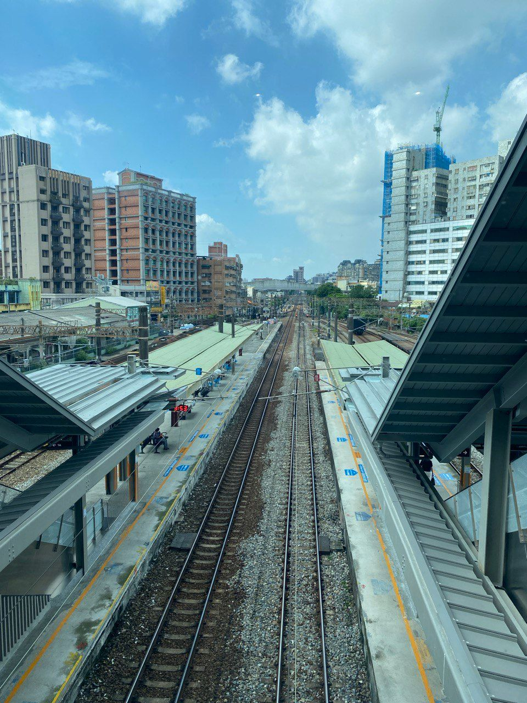

最近認識了許多新朋友，有鑒於每次相見歡，都要重新講一次我的經歷，決定一次分享完整版在網路上面，這也是近年來最詳細的關於我自己的介紹。

目前職涯已經累計12年，目前正往13年邁進，一路走來，我都是在IT產業，從來沒有變換過，算是一試成主顧。

我跟大多數人走的路線不太一樣，我不是直接念研究所，那時候一直覺得大學所學的專業（純數、機械）不太想作為自己的志業（算是一種不務正業？），所以一畢業就直接去當兵了，為了避免浪費時間，直接辦提早入伍，畢業就無縫接軌。

我的第一份工作，是在一間微型企業的軟體公司，這家公司的氛圍有點像工作室，人沒有很多，每天上班都很安靜地在寫程式。這家的產業是在PCB，幾乎所有的PCB大廠都曾是我的服務客戶，主要負責PCB設計的流程優化，簡單來說就是把類似AutoCAD的軟體的操作透過自動化腳本(Python、shell script)輔助人工操作，減少人工介入的時間，導入前後的工時有的流程減少90%，平均減少40%左右，而且完全無紙化，做到哪個步驟會自動記錄，不用人工記憶，另外還有一些是PCB的客製化專案。

這份工作，從白紙做起，大約3年半，期間去大陸出差過幾次，主要解決軟體問題，後來考上了研究所，最後離職先專心把課修完，閒暇時間才處理論文。中途大概「休息」了7個月，嚴格來說是「修習」了7門課，把研究所的畢業修課門檻減少到1門。

後來又繼續待在PCB相關的產業，只是這次換成以AI專案為主，作一套人臉辨識的跨系統解決方案軟體，一開始便是模組是在Linux上，但APP是運行在Windows上，為了做到跨系統資料交換，做了不少嘗試，像是硬體規格的調整，還有軟體層傳輸資料協議的測試，最後得出的結論是透過rabbitMQ交換資料，概念像是開啟一個常駐的傳輸通道，以減少傳送資料的時間，這個做法讓原先傳輸的資料時間從10秒壓縮到1秒，減少90%，但後續為了解決多人同時辨識的問題，最後來是把模組放到Windows上面，以達成即時判斷的需求。

這份工作，只做了半年，後來就被挖角到上市公司，處理GPU相關的專案，這個時期以太幣很夯，所以設計了一套PoW的系統，概念上來說，就是透過GPU核心頻率及GPU記憶體頻率的調整，達到算力最大化的目的；這個專案深化了我跟GPU的緣分。後續幣圈有些轉折，為了更長遠的發展，組織計劃執行AI專案的數位轉型，開啟了在AI產業上的全新道路。

當時兩岸三地有許多學校及科研單位是公司的客戶，為了可以更好地服務客戶，團隊協同開發了一套「GPU調度管理系統」，可以讓使用者自由地分配算力，達到更高的算力使用率，這個過程也不能說沒有插曲，中間碰到一個前端工程師，光速閃離，導致我自己要從後端跨域寫前端，但也因此練就我評估全端的能力，為後續擔任技術主管奠定了基礎。

管理職跟技術職，是兩個完全不同的概念，管理職必須要能將組織的效益最大化，也就是盡可能讓每個人能發揮的程度放大，不是像技術職專注在技術就好，這就很需要溝通能力，還有一些組織協調能力等等，我想，這就是綜觀全局和微觀細節的差異吧。

期間除了持續深化「GPU調度管理系統」之外，還做了幾個AI相關的專案，並與NVIDIA合辦了兩次公開課，參與數據湖及Intel的演講，累積破萬人次觀看；另外還有考取NVIDIA DLI的講師認證，並協助組建對岸的軟體開發與維運的團隊。

這份工作，做了快5年，後續因應組織改組調整，整個部門就獨立出來成立一間新公司，以更好地服務既有的客戶群，並持續深化我們的服務，也就是「賣算力」這件事情，有很多種形式，正在如火如荼地進行，感謝客戶支持。

新公司的這幾年，除了開發雲端系統之外，抽空完成了碩士學位，接著寫鐵人賽，幸運被出版社相中，出了一本書，後續的道路上，認識了許多知性有趣的新朋友，也參與了不少活動和演講，感謝一路上幫助過我的人。

回頭看，裡面有幾個啟示，想跟大家分享：

1️⃣ 繞路不是浪費，跨領域會成優勢
我的背景是純數學與力學，卻一路走進 IT 與 AI。看似「不務正業」，實際上養成了更強的邏輯與分析力，成為後來解決問題的利器。

2️⃣ 小事做到極致，就是練功
從優化 PCB 流程到縮短 資料交換 時間，我不只是完成任務，而是持續加值。這些累積，成為下一段職涯的跳板。

3️⃣ 逆境就是成長加速器
專案中遇到前端工程師離職，迫使我跨足全端。雖然辛苦，但反而練就了更全面的能力。

4️⃣ 管理 ≠ 技術，是另一場修煉
從工程師到主管，最大的挑戰不是寫程式，而是如何放大團隊的價值。

5️⃣ 學習 + 實踐 + 輸出 = 成長循環
演講、寫文章、出書，這些輸出讓我把專業轉化為影響力，也認識更多同道中人。

6️⃣ 技術要服務產業，才有真正價值
從 GPU PoW 到算力調度，再到算力即服務，本質都是用技術解決產業的需求。

📌 職涯沒有標準答案，
只要把每個階段當修煉場，
累積下來的能量，終會成為獨一無二的優勢。

✝️ 最後說一下，我信奉的人生哲學，那就是「了解自己」，唯有如此，你才可以做出正確的選擇，藉此創造人生的正向循環，希望這個分享對你有所幫助。
🌟 祈願 在這條AI賽道上，與各位前輩好朋友一同學習、砥礪前行、持續進步。
