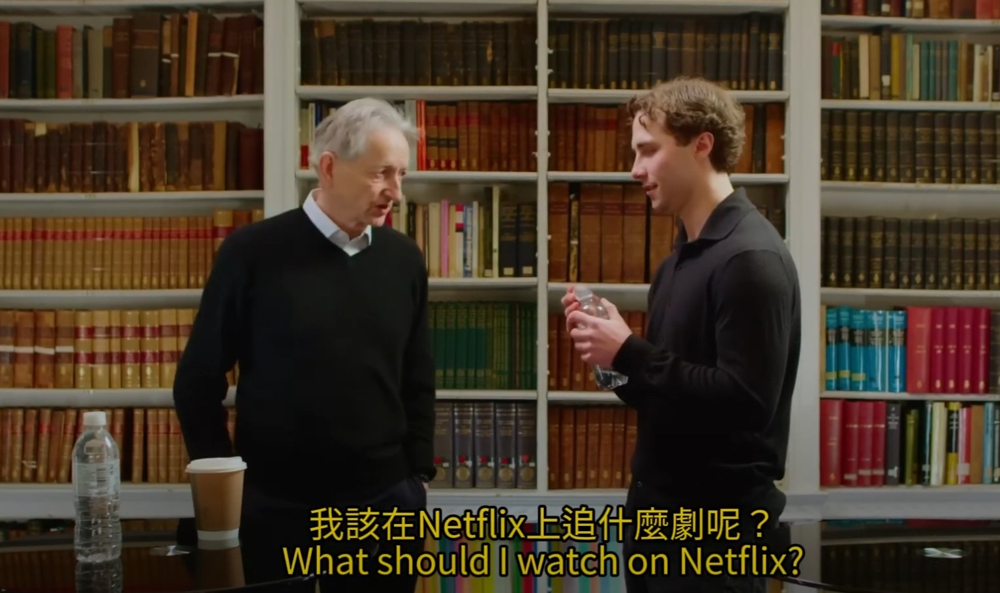

── 辛頓訪談說了啥？自學AI可能嗎？AI四巨頭是誰？

### 前言

這影片提到了先前的辛頓訪談，其實這影片已經出來蠻長一段時間了，主要講述過往研究的一些心路歷程，沒看過的建議去看看原始影片，相信透過大神的思考方式可以給你一些啟發。

最近很多人問我學習AI要從哪開始，嗯...你可以從認識四巨頭開始，因為有相當高比例的文獻是從這裡來的。

一開始不用看書，直接看影片自學即可，不懂的就問ChatGPT，反覆學習，就能逐步學會。

### AI四巨頭

AI四巨頭學術成就簡述（從近期開始）

▋傑佛瑞·辛頓（Geoffrey Hinton）

2022年提出反向傳播的替代方法——前向-前向演算法，這是他最新的重大貢獻。

2017年提出膠囊網路（CapsNets），克服卷積神經網路對圖像中對象層次關係的限制。

2014年推出AlexNet，徹底改變計算機視覺領域，成為深度學習的代表性成果。

▋楊立昆（Yann LeCun）

2017年引入新的數學工具，用於圖上的卷積和池化操作，進一步推動圖像處理的發展。

2014年提出卷積網路框架，用於綜合識別、定位和檢測。

創建MNIST數據集，是機器學習界的經典工具。

▋約書亞·班吉歐（Yoshua Bengio）

2014年提出注意力機制，這一技術成為現代深度學習中處理序列數據的核心。

與Ian Goodfellow合作開發生成對抗網路（GAN），推動計算機視覺的變革。

在自然語言處理、機器翻譯等領域貢獻顯著。

▋吳恩達（Andrew Ng）

2018年創立AI基金，投資於AI新創公司，推動產業發展。

2012年創立Coursera，領導大規模開放在線課程（MOOC）的推廣。

對深度學習中的GPU應用有開創性貢獻，並持續推動AI在教育和商業領域的應用。

四巨頭詳細介紹：

[https://aidc.shisu.edu.cn/ca/64/c13626a182884/page.htm](https://aidc.shisu.edu.cn/ca/64/c13626a182884/page.htm?fbclid=IwZXh0bgNhZW0CMTAAYnJpZBExejNhZW1EZFBVRDluQnl4VwEe2pnp3ciIqO50-8xj5I3Ou_REynet7yrOYvtcfbNCjTvyXjcsd9t_MuI_HqI_aem_aD1j4T6bWY1j15V1XUzGXg)

### 新手建議

另外還有個常見的問題，就是框架要選哪個？我該用Pytorch嗎？那個Tensorflow好像很厲害是不是該學一下？

新手一律推薦Pytorch，因為目前絕大多數文獻的實作它佔比最高，換句話說，你要「抄code」最簡單。

我自學AI比較早，那時候Pytorch用戶還沒很多，所以初期我是用Keras，就Infra出身的開發者會比較習慣。

### 論文實作

想要參考別人論文實作code的話，可以參考Papers with code這個網站

[https://paperswithcode.com/](https://paperswithcode.com/?fbclid=IwZXh0bgNhZW0CMTAAYnJpZBExejNhZW1EZFBVRDluQnl4VwEecIPrg1zruVSytveIsSLlzfS5sjPjCiKB2foSZ0W-5bQtdeb0w0-j-it-86s_aem_LgOATMU825D7bJv2YRPfeg)

