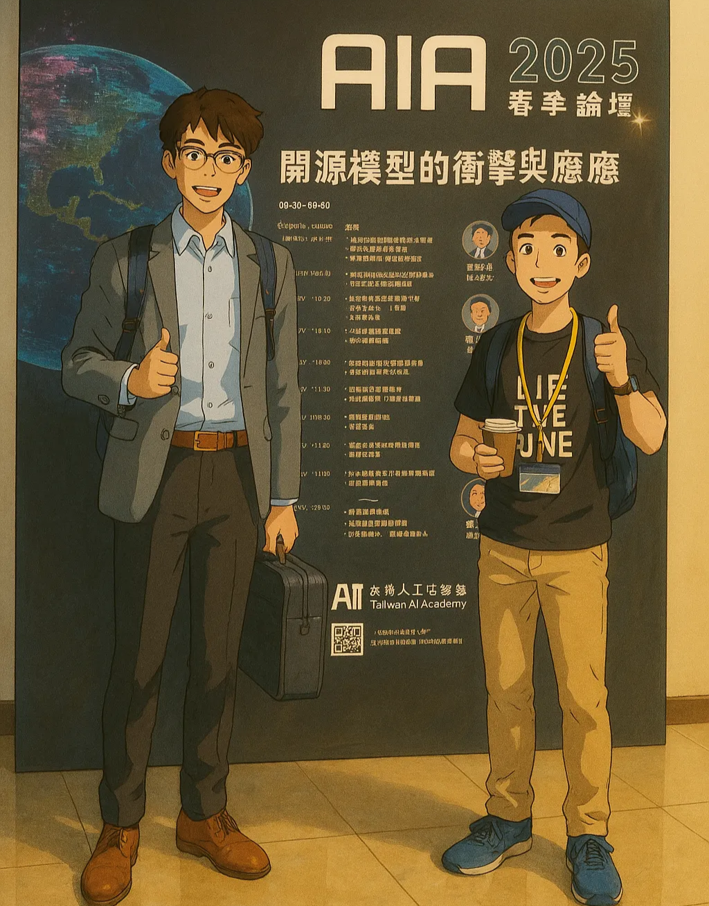
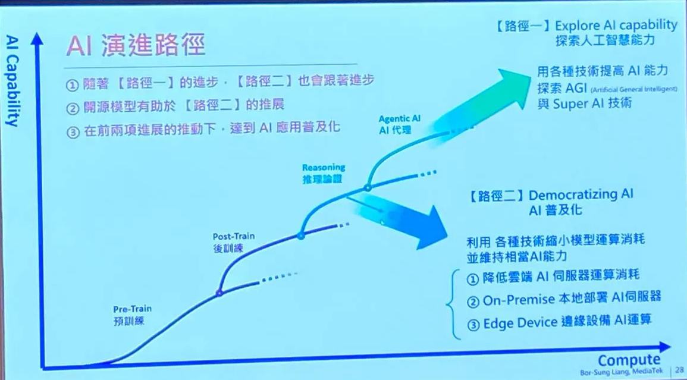
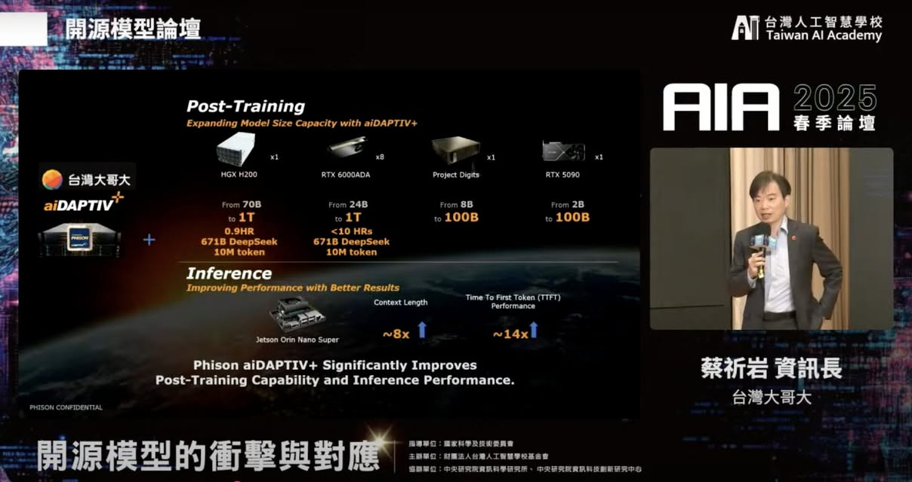
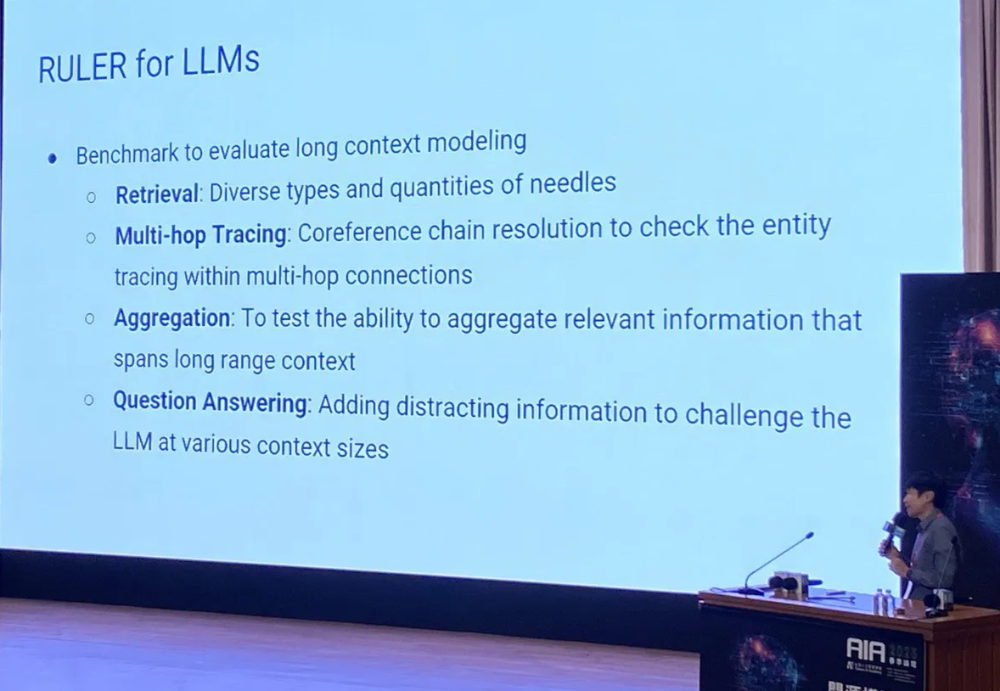
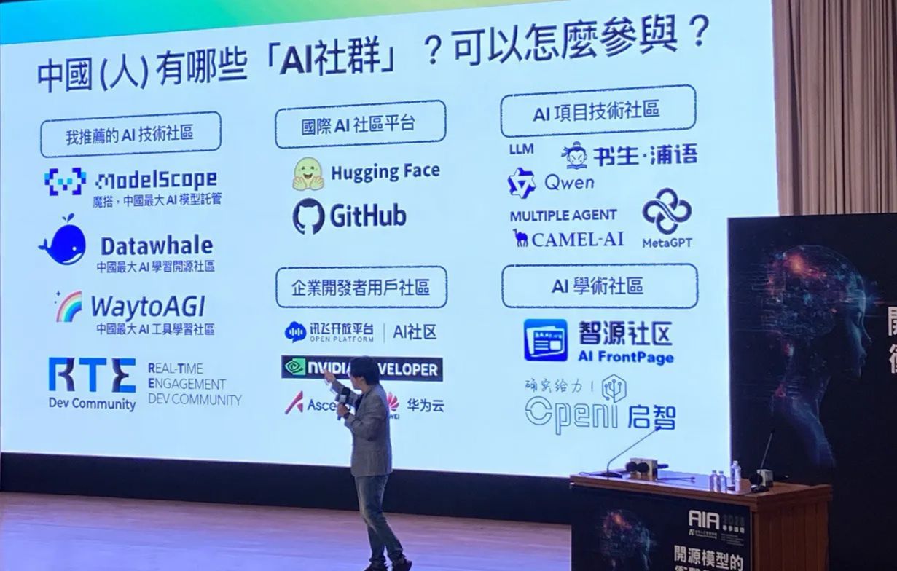
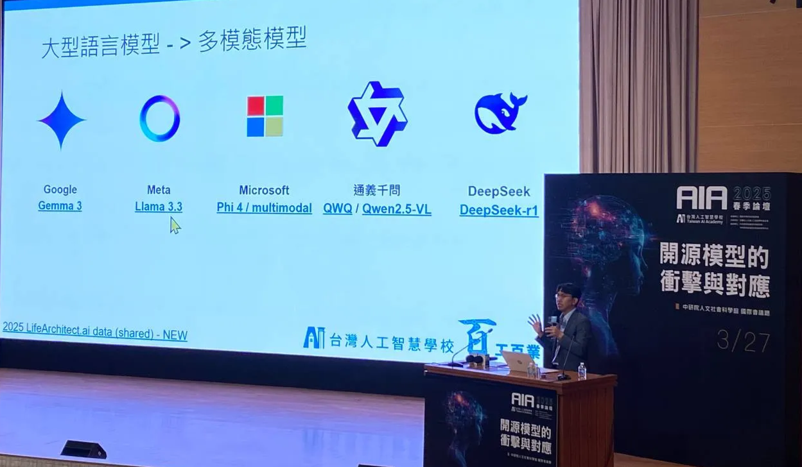
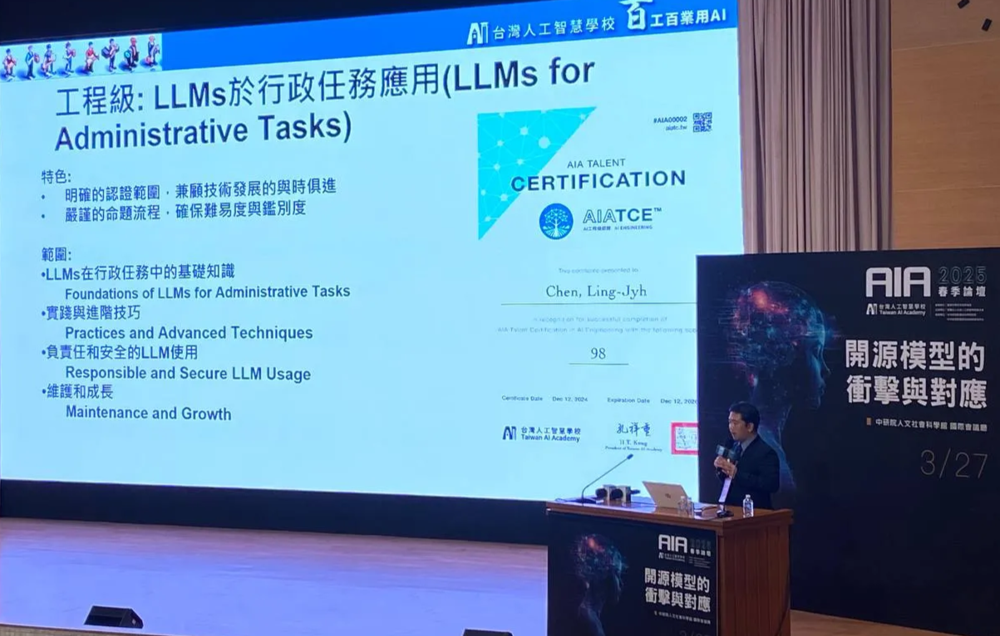

—原圖經OpenAI的「吉卜力風格」生成處理

### 前言

今天非常感謝台灣人工智慧學校的邀請，第一次參加舉辦的春季論壇，據說每季都有，也開放線上參與，歡迎有興趣的朋友來現場交流互動。

雖然很開心地參加論壇，吸收了不少新穎的知識，不過因為太多人要找我了，只好到會議室外打電話，最近真的很忙，生意如雪花般飄來，謝謝各路合作夥伴的支持。

### 活動內容

謝謝所有與會專家精彩的分享！來聊聊活動的內容，主軸圍繞在「開源模型」這個關鍵字。

#### AI演進路徑

從年初的開源模型DeepSeek R1出發，這是個首度開源的Reasoning Model，是一個可以把他的推導過程具現化的模型，你可以清楚看到他推論的步驟，這個概念源自於「快速慢想」這本書；系統一：快速決策，系統二：深度思考。

舉例來說：

1\. 1+1=? 很簡單，答案不用講都知道

2\. 12x23=? 這就要想一下了，不考慮會心算的情況

大腦的運作是非常耗能的，所以他會盡可能地偷懶，大部分系統一能用就用，不行才會切到系統二。

目前AI的時代，可以劃分為四個階段：預訓練(Pre-Train) -> 後訓練(Post-Train) -> 推理論證(Reasoning) -> AI代理(Agentic AI)，目前在三到四之間。

從早期的AlexNet，我們看到了選用Pre-Train Model的重要性，之後了解在後訓練的Fine-tuning也能強化模型的理解程度，而目前則透過Reasoning的方式，讓模型的表現有更大的躍升，未來將轉為全面AI代理的模式，模型專業分工，達到自動推論的最佳化。

#### aiDaptiv+

開源模型論壇的環節，有個挺有意思的橋段是關於台灣大哥大資訊長

[Rock Tsai](https://www.linkedin.com/in/rock-tsai-90b30280/)

介紹的Phison aiDAPTIV+的解決方案，這是一種將SSD的容量用於顯存計算的技術，透過這樣的機制，就能讓消費級的顯卡跑LLM的模型訓練，像是用RTX4090跑Llama-3.3-70B的模型訓練。

#### LLMs的規則

大型語言模型(LLM)是有PK的儀表板可以看的，常見的LLM Leaderboard可以參考LMSYS，大廠的開源模型真的會看排行（真是肝，壓力山大XD）；Context Window是個重要的概念，夠大的話可以不用RAG，也能讓用RAG的效果更好(CAG，用Cache快取加速)；另外關於MoE(Multi-of-Expert)的選擇是看有沒有多個GPU，有的話用效果才好，MoE在單個GPU的表現並不明顯。

#### 中國的開源AI發展現狀

[Richard Lin](https://www.linkedin.com/in/richardllin/)

有分享關於AI在中國的發展現況，也介紹了一些不錯學習的資源；很開心看到好友

#### 好用的開源工具

[Cheng Lin Tsai](https://www.linkedin.com/in/cheng-lin-tsai-448b6b119/)

的精彩分享，介紹了許多好用的開源工具，有很多在Sailflow AI上都有喔！政霖常抽空分享技術文件給我，非常感謝他，幫高調；另外感謝台灣人工智慧學校校務長

#### AI素養認證

[Richie Tsai](https://www.linkedin.com/in/richietsai/)

的招待，是個我特別景仰的業界前輩，還多塞了一盒點心給我，這次包含線上總共將近800人，相信會越來越好，預祝未來活動順順利利、一切圓滿。

台灣人工智慧學校真的很酷，每一季都會推出新花樣，像這次有Demo新出的開源工具，以及「工程級」的AI素養認證，對課程及認證有興趣可以聯繫他們。

其他精彩內容，可以參考活動回放：

[https://lnkd.in/gsXGCe4K](https://lnkd.in/gsXGCe4K)

台灣人工智慧學校素養認證：

[https://lnkd.in/gNpavzXP](https://lnkd.in/gNpavzXP)

