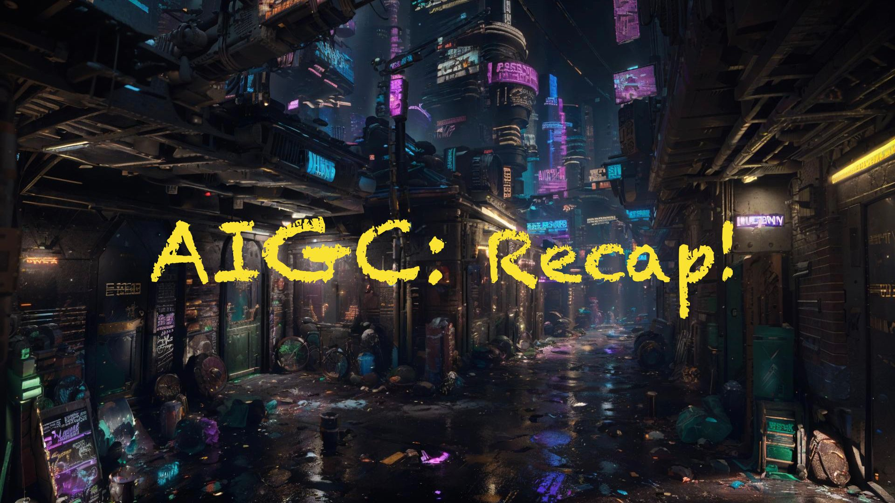
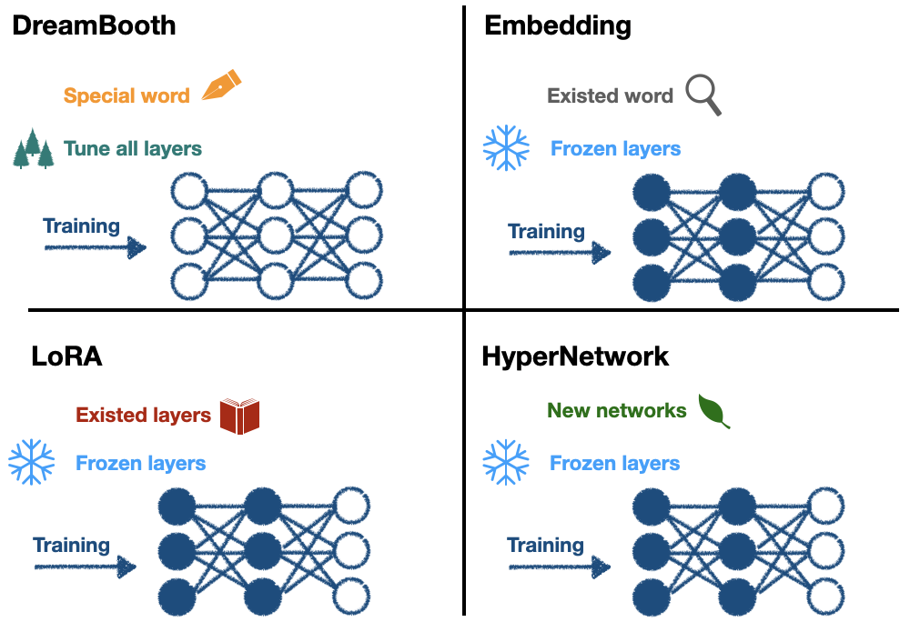

## \[Day30\] 全文總結：AIGC的前世今生

Author: Nick Zhuang
Type: AI & Data

### 提要

[前言](https://www.notion.so/Title-1e8d2b687266808ca88ddeda8e1c0503#%E5%89%8D%E8%A8%80)

[SD理論篇](https://www.notion.so/Title-1e8d2b687266808ca88ddeda8e1c0503#sd%E7%90%86%E8%AB%96%E7%AF%87)

[SD應用篇](https://www.notion.so/Title-1e8d2b687266808ca88ddeda8e1c0503#sd%E6%87%89%E7%94%A8%E7%AF%87)

[結論](https://www.notion.so/Title-1e8d2b687266808ca88ddeda8e1c0503#%E7%B5%90%E8%AB%96)

### 前言

今天我們會介紹30天以來總結相關的內容，本日內容包含：SD理論篇、SD應用篇、及結論。

### SD理論篇

我們從定義 AIGC ( [「Day2」：什麼是AIGC？](https://nick-zhuang.notion.site/1e9d2b687266809887f1dbd5800e6a60?pvs=25)) 的角度出發，賦予 AIGC 新的定義：AIGC = PGC + UGC，並探討 AIGC 的演進 ( [「Day4」：AIGC的演進](https://nick-zhuang.notion.site/1e9d2b68726680a0b1aad118f8725125?pvs=25))，涵蓋多個圖像生成模型的領域；例如，VAE ( [「Day5」：VAE](https://nick-zhuang.notion.site/1e9d2b6872668072929dd74a75aa6b62?pvs=25))、GAN( [「Day6」：GAN](https://nick-zhuang.notion.site/1e9d2b68726680738259c7fa6400c1ec?pvs=25))、Pixel RNN( [「Day7」：Pixel RNN](https://nick-zhuang.notion.site/1e9d2b6872668072a09be3e4ec387f3b?pvs=25))、Flow( [「Day8」：Flow](https://nick-zhuang.notion.site/1e9d2b68726680bfaa1bd0ad16488cbc?pvs=25))、及 Diffusion( [「Day9」：Diffusion](https://nick-zhuang.notion.site/1e9d2b68726680bbaf43eeb616d089df?pvs=25))，在這其中除了 Pixel RNN 以外，都具有雙向逆反的組件，而 Diffusion 中的擴散模型架構，為後的 Stable Diffusion ( [「Day14」：Stable Diffusion](https://nick-zhuang.notion.site/1e9d2b6872668032a2fcd1f3b1c7ee0e?pvs=25)) 拉開了序幕。

2021年，Dhariwal et al. 提出的論文 Diffusion Models Beat GANs on Image Synthesis，指出在圖像生成領域上，Diffusion模型已經超越了GAN的表現。2023年3月，Peebles et al. 提出的論文 Scalable Diffusion Models with Transformers，代表已經有人嘗試以 Transformer ( [「Day10」：Transformer](https://nick-zhuang.notion.site/1e9d2b68726680049bbcfff1ab9fee1a?pvs=25)) 的架構取代 Diffusion Model 中的 U-Net ( Stable Diffusion Model 也是用 U-Net )，嘗試去探索其架構的必要性，之所以在 Diffusion Model 中使用 U-Net 架構的原因是來自於過往研究的經驗；例如，Pixel CNN，當時以這樣的架構就可以有不錯的表現，因此才沿用至今，接著透過 CLIP ( [「Day12」：CLIP](https://nick-zhuang.notion.site/1e9d2b68726680b5912ad1470c2e992e?pvs=25)) 的技術，巧妙地將文與圖的關係建立，將其概念加入到 Stable Diffusion ( Latent Diffusion Model )。

至於 NeRF( [「Day11」：NeRF](https://nick-zhuang.notion.site/1e9d2b68726680b69ec0c1711f8f0444?pvs=25))，神經輻射場，算是不同於 ViT ( Vision Transformer ) 的研究方向，它的主軸概念是可以將視點建模，實現了單場域內的任意視點生成，這意味著如果將來算力足夠的情況下，以這樣邏輯生成的圖片可以任意拉近拉遠，旋轉視角也不會有問題，就像看到真的物體一樣，因為它已經將該場域內所有物體都建模，任何視角去看都不會有問題，這種方式比較接近我們人類在真實世界的感覺。

模型微調方面，介紹了 Parameter-Efficient Fine-Tuning (PEFT)，探討了 Pre-Trained Model 的概念，我們已經知道，由於大型模型參數量龐大，要重新訓練會相當耗費時間成本，有鑑於此，有效率的微調模型的手法就相當重要，常見的做法是 Linear probe，透過預訓練模型加上凍結部分不需要訓練的層，只訓練後面的少數的必要層。與 SD 相關的包含：Embedding ( [「Day17」：Embedding](https://nick-zhuang.notion.site/1e8d2b687266807fb94afb8f922ee7d7?pvs=25))、DreamBooth ( [「Day18」：DreamBooth](https://nick-zhuang.notion.site/1e8d2b68726680ec974dfc9cbe016d01?pvs=25))、LoRA ( [「Day19」：LoRA](https://nick-zhuang.notion.site/1e8d2b6872668020b5c8fb97c7276be4?pvs=25))、HyperNetwork ( [「Day20」：HyperNetwork](https://nick-zhuang.notion.site/1e8d2b68726680e4a239c4b429eb4d60?pvs=25))。詳細的比較，參考下圖。

DreamBooth 會創造一個新詞作為詞嵌入，會重新訓練所有層；Embedding 會尋找一個既有的詞用作詞嵌入，凍結部分層去做訓練；LoRA 會從 U-Net 特定層加入特定權重，這種架構好比從一本書去加入書籤，書籤就是 LoRA 的內容，我們還會拿筆在加入書籤的地方寫些小筆記，即基於 low rank 的方法，並凍結部分層去做訓練；HyperNetwork 會從 U-Net 的交叉注意力模組中加入特定的網路模塊，並凍結部分層去做訓練。

我們還回顧了其他的 SD 模型控制方法；例如，ControlNet ( [「Day24」：ControlNet](https://nick-zhuang.notion.site/1e8d2b687266806ba36bf7451f04dc77?pvs=25))、T2I-Adaptor、及Composer，這些方法可以生成更加客製化的圖像。並介紹了SwinIR ( [「Day25」：SwinIR](https://nick-zhuang.notion.site/1e8d2b687266805596d8ccf7c3b4c2f2?pvs=25))，這是一種相較於LR、ESRGAN、及Real-ESRGAN而言，更有效率的圖像重建方法。

最後，我們探討了 SD XL( [「Day29」：SD XL](https://nick-zhuang.notion.site/1e8d2b687266808ebcaaec4768b14376?pvs=25))，一個新穎的 SD 改良架構，雖然增加了6倍左右的網路參數量，但生成時間只有增加20~30％，且可以生成更高品質的圖像。

### SD應用篇

我們從 AIGC 的應用( [「Day3」：AIGC Applications](https://nick-zhuang.notion.site/1e9d2b68726680d5895dcf748570a1bb?pvs=25))出發，以此為基礎介紹了常用的生成圖像工具( [「Day13」：GAI Tool](https://nick-zhuang.notion.site/1e9d2b6872668043b9c9db94ab8a4f5f?pvs=25))；例如，DALLE、Midjourney、及Stable Diffusion，我們實作了 SD 的安裝方法( [「Day15」：SD Installation](https://nick-zhuang.notion.site/1e9d2b687266803083ebfa42a148dae4?pvs=25))、及 SD 的基本使用方式( [「Day16」：SD Basic](https://nick-zhuang.notion.site/1e8d2b68726680e08ea5c22f869acc82?pvs=25))( [「Day21」：Civitai](https://nick-zhuang.notion.site/1e8d2b68726680818d9bdb97ee49fc4b?pvs=25))，介紹了常用的插件( [「Day22」：SD 基礎插件](https://nick-zhuang.notion.site/1e8d2b687266801ba8eacafcf287b2d9?pvs=25))( [「Day23」：SD 進階插件](https://nick-zhuang.notion.site/1e8d2b68726680d9999df6f6079b4ff4?pvs=25))，並將使用技巧整合在一起( [「Day26」：SD Advanced](https://nick-zhuang.notion.site/1e8d2b687266805f979ce6ee6182954a?pvs=25))，最後以訓練模型的方式作為後續的優化方式( [「Day27」：Training Checkpoint](https://nick-zhuang.notion.site/1e8d2b68726680a0b848c037848481b0?pvs=25))( [「Day28」：Training LoRA](https://nick-zhuang.notion.site/1e8d2b68726680939a4aead23e32b99c?pvs=25))。

### 結論

本系列文以 AIGC 的宏觀視角出發，回顧了過往的 AI 生成圖像架構；例如，VAE、GAN、及 Diffusion，並以 Stable Diffusion 為基準，探索了 GAI 的前世今生，延伸議題方面，筆者建議以下方向：

GAN 的演進，關於 SD 工具中使用到的 GAN 種類並未詳細探討。

Transformer 的演進，不同種類的注意力機制？使用時機與差異？

Parameter-Efficient Fine-Tuning (PEFT) 總共有哪些種類與變體？使用時機為何？

LLM 與擴散模型的關聯，談談 LLAVA 的技術與應用。

AIGC 的道德議題，Trusty AI 如何做到？

以目前的整體結論來說，我們已經知道，Stable Diffusion 是有潛力的架構，除了有厚實的理論為基底外，開源的工具完整度也已達到相當水準，光以每週更新迭代的速度就可見其熱門的程度，AIGC 的時代已經來臨，也許我們每個人，都能夠期待，那個更好的明天，一個強 AI 普及的世代。

### 致謝

感謝各位邦友及評審們閱讀我的作品，筆者在既有內容上面已盡力補齊相關知識供讀者參考，若有不足之處還請大家多包涵，希望本系列文可以帶給大家一些啟發、讓普羅大眾更容易了解 AIGC 相關的知識，感謝一路幫助我的人，祝大家萬事順心，謝謝大家。

### 參考連結

[Diffusion Models Beat GANs on Image Synthesis](https://arxiv.org/abs/2105.05233)

[生成模型之PixelCNN](https://zhuanlan.zhihu.com/p/461693342)

[Convolutional Networks for Biomedical Image Segmentation](https://arxiv.org/abs/1505.04597)

[LLaVA: Large Language and Vision Assistant](https://llava-vl.github.io/)

