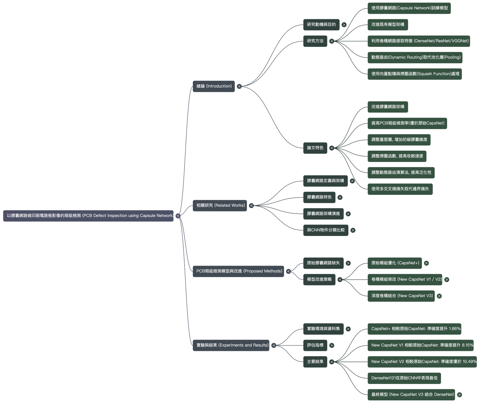

# Revolutionizing PCB Quality Control with Advanced Capsule Networks

## 1.0 The Challenge in Modern Electronics Manufacturing: The Limits of Traditional PCB Inspection

The quality of a Printed Circuit Board (PCB) is the bedrock upon which the reliability of any modern electronic device is built. As a foundational component, the PCB directly governs the performance and longevity of everything from consumer smartphones to mission-critical aerospace systems. As these devices demand ever-increasing complexity and miniaturization, the PCBs that power them have become extraordinarily dense and intricate. This escalating complexity is pushing traditional inspection methodologies to their operational limits, creating significant risks to manufacturing quality, cost control, and production efficiency.

For decades, Automated Optical Inspection (AOI) has been the industry standard for quality control. However, these conventional systems are increasingly struggling to keep pace. Their accuracy is fundamentally undermined by two key challenges: **lighting variability** and **PCB complexity**. Subtle changes in ambient light can alter an image just enough to confuse a rule-based AOI system, leading to incorrect classifications. Similarly, the sheer density of components and traces on a modern board creates a complex visual environment where it is difficult for traditional algorithms to reliably distinguish between acceptable variations and genuine defects.

The business consequences of these limitations are severe. Inaccurate inspections, particularly a high rate of false positives, force manufacturers to depend on costly and time-consuming **manual re-verification**. This process introduces a significant production bottleneck, pulling skilled technicians away from higher-value activities to perform repetitive checks. This reliance on manual intervention is a critical **pain point** for the industry, inflating labor costs, slowing down production cycles, and introducing the potential for human error. To break through this ceiling of efficiency and quality, a new technological paradigm is required. The rise of deep learning offers a powerful solution, promising to transcend the rigid limitations of traditional AOI and usher in a new era of intelligent, automated quality control.

## 2.0 The Deep Learning Paradigm Shift: From Standard CNNs to Intelligent Capsule Networks

While deep learning presents a powerful alternative to traditional AOI, it is crucial to recognize that not all neural network architectures are equally suited for the nuanced task of PCB defect detection. The most prevalent approach, the Convolutional Neural Network (CNN), has demonstrated remarkable success in general image analysis, but it possesses an inherent architectural weakness that limits its effectiveness in high-precision industrial applications. This section compares the predominant CNN approach with a more advanced architecture—the Capsule Network—to reveal a critical technology gap and a superior path forward.

Convolutional Neural Networks, including well-known architectures like VGGNet, ResNet, and DenseNet, have become the workhorses of computer vision. They excel at identifying features within an image. However, their primary weakness lies in a core operation known as "pooling." Pooling layers are designed to reduce the computational load by down-sampling feature maps, but in doing so, they discard crucial spatial information about the precise orientation, position, and relationship of the features they detect. This property, known as **invariance**, makes a CNN robust to the general location of an object but less sensitive to its specific pose—a critical detail when trying to identify subtle manufacturing defects on a PCB.

Capsule Networks (CapsNets) were conceived to overcome this exact limitation. They represent a superior architectural philosophy that retains vital spatial information. Instead of using single scalar values to represent the presence of a feature, CapsNets use vectors. The length of the vector indicates the probability that a feature exists, while the vector's direction encodes its properties, such as orientation, position, and scale. This property, known as **equivariance**, means that as an object changes its pose, the feature representation changes predictably, rather than being discarded. This approach is more analogous to how the human visual system processes information, allowing the network to build a more robust and context-aware understanding of the object it is analyzing.

**Table 2.1: Architectural Comparison - CNN vs. Capsule Network**

| Attribute | Convolutional Neural Network (CNN) | Capsule Network (CapsNet) |
| --- | --- | --- |
| **Input** | A single scalar value representing feature activation. | A vector (`uᵢ`) where length indicates feature probability and direction encodes spatial properties. |
| **Activation Function** | Non-linear functions like ReLU or Sigmoid that operate on a scalar input. | A "Squashing" function that normalizes the vector length between 0 and 1 without altering its direction. |
| **Output** | A single scalar value (`yⱼ`) representing the final classification score. | A final vector (`vⱼ`) that preserves the rich feature and spatial information for a more robust classification. |

The vector-based philosophy of Capsule Networks provides several distinct advantages over traditional CNNs:

- **Enhanced Generalization:** By understanding the spatial relationships between features, CapsNets can recognize objects from new or unseen viewpoints with significantly less training data than a comparable CNN.
- **Greater Parameter Efficiency:** The architecture requires substantially fewer parameters to achieve high performance. In one benchmark on the MultiMNIST dataset, a CapsNet required only 11.36M parameters compared to a CNN's 24.56M.
- **Improved Interpretability:** CapsNets are inherently less of a "black box." Because the vectors encode specific properties, it is easier to analyze the network's internal reasoning, making it more verifiable and trustworthy for industrial applications.
- **Robustness Against Adversarial Attacks:** Unlike CNNs, whose accuracy can be crippled by subtle, malicious pixel changes from attacks like FGSM, CapsNets have demonstrated significantly higher resilience. In tests, they have maintained over 70% accuracy under attack, making them a more reliable choice for mission-critical security and quality systems.

While the theoretical power of Capsule Networks is clear, the original, standard implementation had its own limitations that prevented it from reaching peak performance in a demanding industrial setting. Unlocking its full potential required a systematic, multi-stage process of research and architectural enhancement.

## 3.0 Engineering Excellence: A Multi-Stage Journey to Peak Performance

Transforming the promising concept of a Capsule Network into a robust, industrial-grade solution required a methodical, four-stage research and development process. This journey was not a single breakthrough but a series of targeted architectural enhancements, with each stage building upon the last to systematically eliminate weaknesses and boost performance. This section details the specific engineering improvements made at each stage and the corresponding gains in detection accuracy.

## 3.1 Stage 1: Foundational Enhancements (CapsNet+)

The first stage of optimization focused on the fundamental building blocks of the CapsNet architecture. The research team implemented targeted improvements to the `squash function` (the vector-based activation), the `dynamic routing algorithm` that passes information between layers, and the dimensionality of the `primary capsule` layer where initial features are formed.

- **Quantitative Result:** These foundational tweaks immediately validated the approach. This boosted accuracy by **1.86%**, precision by **1.87%**, and recall by **1.86%** over the baseline CapsNet model.

## 3.2 Stage 2: Convolutional Module Refinement (New CapsNet V1)

The team then tested a counterintuitive hypothesis: could a *less* complex convolutional front-end actually improve performance by providing a cleaner, more focused feature set to the capsule layers? This stage involved simplifying and reducing the initial convolutional layers that feed into the capsule network to test if a more streamlined feature set could improve the capsule layers' ability to converge.

- **Quantitative Result:** This simplification led to a significant performance leap. The resulting `New CapsNet V1` model saw its accuracy, precision, and recall increase by **8.15%**, **8.08%**, and **7.99%** respectively over the original model.

## 3.3 Stage 3: Architectural Expansion (New CapsNet V2)

Having validated the efficiency of a streamlined front-end, the next stage explored the opposite vector: architectural depth. The question was whether adding hierarchical capacity through additional convolutional and capsule layers would enhance the model's ability to extract the more complex and intricate patterns present in high-resolution PCB images.

- **Quantitative Result:** This architectural expansion pushed performance even further, achieving an improvement of over **10.49%** in accuracy, **9.58%** in precision, and **10.58%** in recall compared to the baseline CapsNet.

## 3.4 Stage 4: Deep Convolutional Fusion (The Final Model: New CapsNet V3)

The fourth and final stage represented the most critical leap in performance. The research team integrated a powerful, pre-trained deep convolutional network to act as a highly advanced feature extractor, effectively fusing the pattern-recognition strength of a state-of-the-art CNN with the spatial reasoning of a Capsule Network. After a comparative analysis of leading architectures—including VGGNet, ResNet, Inception, and MobileNet—**DenseNet** was selected. DenseNet was chosen as it demonstrated the best balance of exceptional accuracy (98.46%) and parameter efficiency, outperforming VGGNet-19 in performance and ResNet-50 in both performance and model complexity.

To maximize the synergy between these two architectures, a final set of strategic optimizations was implemented:

- The loss function was switched from margin loss to **categorical cross-entropy loss** for better optimization.
- The optimizer was upgraded from the standard Adam to **AdamW**.
- The **ReduceLROnPlateau** learning rate strategy was implemented to fine-tune training dynamically.
- The routing iterations for the final capsule layer were increased from 3 to **7** to improve consensus.
- Extending the training epochs from 100 to **350** to ensure full model convergence.

This rigorous, multi-stage optimization process culminated in the final `New CapsNet V3` model—an architecture engineered for peak performance and ready for benchmarking against industry-standard deep learning models.

## 4.0 Benchmark Results: Defining a New Standard in Detection Accuracy

The ultimate measure of any AI model's value is its empirical performance on real-world data. After a rigorous development process, the final, optimized `New CapsNet V3` model was benchmarked against both its predecessors and a suite of established, industry-standard deep learning models on a comprehensive PCB defect dataset. The results demonstrate a clear and decisive performance advantage, establishing a new gold standard for accuracy and reliability in automated inspection.

**Table 4.1: Final Performance Benchmarks on PCB Defect Dataset**

| Model | Accuracy | Precision | Recall | F-score |
| --- | --- | --- | --- | --- |
| **New CapsNet V3** | **99.22%** | **99.22%** | **99.22%** | **99.22%** |
| DenseNet-121 | 98.46% | 98.46% | 98.46% | 98.46% |
| VGGNet-19 | 98.14% | 98.14% | 98.14% | 98.14% |
| ResNet-50 | 95.83% | 96.01% | 95.83% | 95.80% |
| Original CapsNet | 83.38% | 84.82% | 83.38% | 82.76% |

The data unequivocally shows that the `New CapsNet V3` model achieved an exceptional **99.22%** across all key performance metrics: accuracy, precision, recall, and F-score. This near-perfect result not only represents a massive leap over the original Capsule Network but also surpasses the performance of leading conventional CNNs like DenseNet-121 and VGGNet-19 on the same challenging inspection task.

For manufacturing decision-makers, these technical metrics translate directly into tangible business impact:

- **Reduced Labor Costs:** An accuracy and precision rate of 99.22% drastically reduces false positives. This minimizes the need for expensive and time-consuming manual re-inspection, freeing up skilled technicians to focus on higher-value tasks that cannot be automated.
- **Improved Product Quality & Reliability:** Near-perfect recall ensures that virtually no defects are missed. This prevents faulty PCBs from reaching downstream assembly stages or, worse, being shipped to customers, thereby safeguarding end-product quality, reducing warranty claims, and protecting brand reputation.
- **Increased Throughput:** A highly reliable, fully automated inspection system eliminates the production holds and bottlenecks associated with manual quality checks. This leads to smoother, more efficient manufacturing cycles and a faster time-to-market.

The improved Capsule Network does not merely offer an incremental improvement over existing methods. It represents a new gold standard, delivering a level of accuracy and reliability that redefines what is possible in automated PCB inspection.

## 5.0 Conclusion: A New Standard for Automated Inspection

This white paper has detailed the systematic journey of transforming a promising academic concept—the Capsule Network—into a high-performance industrial solution. By methodically identifying and resolving the weaknesses of the original architecture and strategically fusing it with the power of modern deep convolutional networks, we have developed a model that decisively outperforms both traditional AOI systems and standard deep learning approaches for PCB defect detection.

The value proposition of this advanced technology is clear and is summarized by three key takeaways:

1. **Superior Accuracy:** The final `New CapsNet V3` model delivers state-of-the-art performance, achieving **99.22%** accuracy, precision, and recall. This level of reliability translates directly into higher product quality, lower scrap rates, and reduced operational costs.
2. **Architectural Advancement:** The intelligent fusion of a deep convolutional backbone (DenseNet) with the spatially-aware logic of Capsule Networks creates a uniquely robust and effective model. This architecture is purpose-built to handle the complex visual analysis required for modern industrial inspection tasks.
3. **Proven Business Value:** This technology directly addresses critical industry pain points. It mitigates the risk of shipping defective products, reduces the costly reliance on manual labor for re-verification, and streamlines production workflows by eliminating inspection bottlenecks.

This work represents more than a novel application of Capsule Networks; it is a demonstration of a new, hybrid architectural paradigm. This "fused" approach provides a new optimization direction, attempting to solve complex perception problems from a more human-like perspective. By combining the raw feature extraction power of deep CNNs with the contextual and spatial reasoning of CapsNets, this methodology serves as a key step toward more robust, interpretable, and powerful AI perception for the next generation of complex industrial environments.
