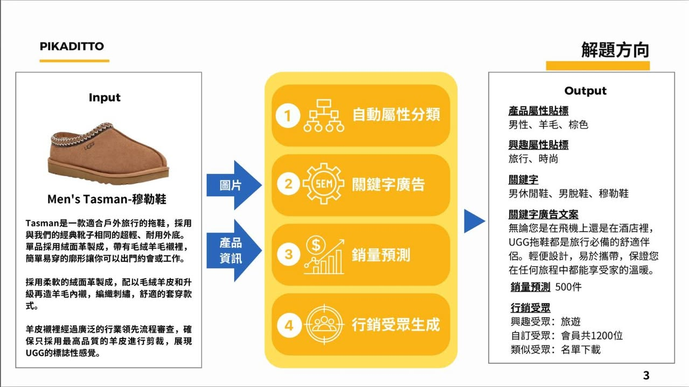
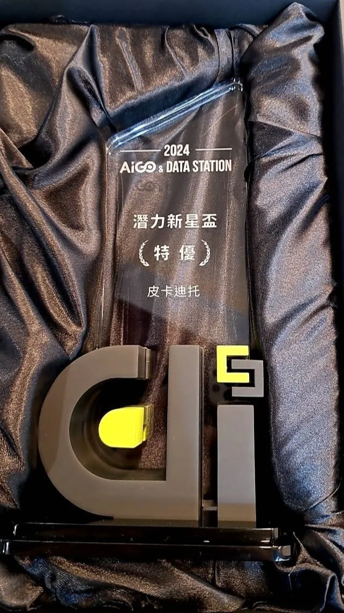

### 前言

為期半年的AIGO潛力新星盃總算結束了，週五的頒獎典禮為這趟旅程劃下完美的句點，第一次參賽就拿到最佳獎項，實屬不易，週日還有Demo成果的發表會。

### 參賽歷程

感謝我的參賽夥伴 [Jim Lin](https://www.facebook.com/linjimyal?__cft__[0]=AZX0Vy2b-BQWaxDHc4c1bW9TfBqXwxkiYbuwTsVbBUgaBayQrC1LzTukG62SkIJhfBdQ32wHHVUcB5W-NnljExaMdjbR0y3UnHeS5C1F2BWsN3QFBylI6sILwYVjGqAzp7f0CoziwiUDGHVtqYBEMt1jSftfJujY3mpkQKXC4vXL05o_xnEfnci-2DUIWpSjOGA&__tn__=-]K-R)，提供了許多的行銷方面的關鍵知識，從5月底開賽以來我們就密切的討論，從提案到初步審查，從廠商給定資料到交出結案成果及報告，付出了不少心力，當然我也不輕鬆，因為所有的實作程式碼都是我寫的，透過與Cursor協作的方式逐步實現，從開工到結束，大約是完整的一個月左右（燒肝大法之無限循環），包含：訓練模型（預測與自動分類）、清洗數據的腳本、廣告的關鍵字生成、及最終的行銷文案生成，這些功能大都有UI作為操作介面。

我不敢說我是最強的，但我絕對不差，我組建及帶領過軟體團隊，很清楚從0到1要做什麼，兩岸三地協作過很多次，也與NVIDIA合作過數次，只是看見我的人太少，了解我的人也太少，所以就這樣默默無名了很長一段時間（現在可能還是一樣XD）。一個人還是要有真材實料，在江湖上才能闖蕩的久，要能展現實力還是要有些底蘊才行，後續情況如何，就看馬太效應是否站在我這一邊了。

### Cursor魔力

來講講Cursor，以目前AI整體寫code的能力來說，我給70分，他可以寫簡單的函式，像是1加到10，有些不太熟悉的語法也可以直接問他，對於很有經驗的人來說，最好不要太期待他比你厲害，基本上不可能，舉個例子：明明已經可以明顯看出有一行改了就能執行，但他經過我給的提示才發現哈，不過他基本功還可以，你可以透過與他對話的方式獲得靈感，在有些情況下，他可以激發你新的想法，詳細我使用Cursor的流程，另外整理成一篇分享，也融合一些過往的經驗談，這樣會比較完整，敬啟期待！

今天的時間就先留給慶功吧！目前人在大陸出差，可能回覆稍慢，有什麼想了解的，都可以聊聊，晚安！

P.S. 行銷文案生成的APP是使用 [Sailflow AI](https://www.facebook.com/Sailflow.ai.cloud?__cft__[0]=AZX0Vy2b-BQWaxDHc4c1bW9TfBqXwxkiYbuwTsVbBUgaBayQrC1LzTukG62SkIJhfBdQ32wHHVUcB5W-NnljExaMdjbR0y3UnHeS5C1F2BWsN3QFBylI6sILwYVjGqAzp7f0CoziwiUDGHVtqYBEMt1jSftfJujY3mpkQKXC4vXL05o_xnEfnci-2DUIWpSjOGA&__tn__=-]K-R) 構建的，歡迎有興趣的朋友多加利用，我的推薦碼：R5QXRVE6

