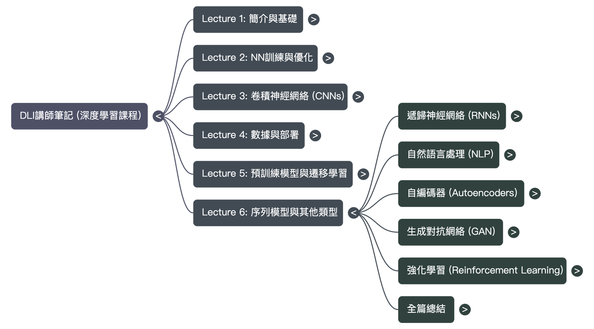

## Lecture 1 - Introduction

## Outclassed By Von Neumann Architecture

- [TD-learning, neural networks, and backgammon](https://www.cs.cornell.edu/boom/2001sp/Tsinteris/gammon.htm)
- [NN History: The 1940’s to the 1970’s](https://cs.stanford.edu/people/eroberts/courses/soco/projects/neural-networks/History/history1.html)
- [Von Neumann Architecture](https://www.computerscience.gcse.guru/theory/von-neumann-architecture)

## Expert Systems

- [Putting Expert Systems to Work](https://hbr.org/1988/03/putting-expert-systems-to-work)
- [Expert system - Britannica](https://www.britannica.com/technology/expert-system)

## Computing Power

- [How Many Megapixels Is the Human Eye?](https://www.discovery.com/science/mexapixels-in-human-eye#:~:text=According%20to%20scientist%20and%20photographer,what%20does%20this%20mean%2C%20really%3F)
- [NVIDIA Marbles RTX Video](https://www.youtube.com/watch?v=H0_NZDSqR3Y&t=31s)

## Deep Learning

- Khan, A., Sohail, A., Zahoora, U., & Qureshi, A. S. (2020). A survey of the recent architectures of deep convolutional neural networks. Artificial Intelligence Review, 1-62.[LINK](https://arxiv.org/ftp/arxiv/papers/1901/1901.06032.pdf)

## Other Reference

- [計算機開啟的流程](https://blog.csdn.net/enlaihe/article/details/84955026)

## 投影片資料

- 兩個重大事件共同催生了當今的深度學習時代
    - 首先是數據。為了讓神經網路學會理解任務，需要讓它接觸許多不同的數據。為了讓神經網路了解貓是什麼，需要首先為它展示大量貓咪的圖片，以及許多並非貓咪的圖片。互聯網時代給神經網路的學習提供了海量數據。
    - 現代深度學習崛起的另一個主要因素是處理能力。為了有效地訓練人工“大腦”，首先我們要思考一下人類的大腦。我們在一秒鍾的時間裏，可以觀察多少 GB 的信息？生活的“幀率”是多少？人眼的分辨率是多少？雖然當今的 AI 成績驕人，但我們人類在一秒鍾內能處理的數據量要遠遠超越 AI。為了盡量趕上人類的能力，機器可以利用的一種方式就是提高計算能力。
- GPU的重要性
    - 事實證明，神經網路本質上就是一種矩陣乘法器。還有哪些其他類型的問題需要執行大量的矩陣乘法？計算機圖形！在這門科學中，計算機圖形對象以許多極小的三角形表示，這些小三角形相互配合，展現出豐富的視覺效果。在動畫、模擬和遊戲中，這些小三角形需要頻繁變換和旋轉，這就需要矩陣計算。
    - 由於神經網路與圖形都建立在相同的基本數學問題之上，因此，兩者的硬件可以切實有效地互換使用也就不足為奇了。
    - 針對這種訓練，一項尤為重要的發明就是並行處理器。神經網路訓練所需的數學運算並不是特別複雜，但是必須要執行數百萬、數十億或數萬億次，而且最好能同時執行這些運算。
    - 一般來說，您使用的 CPU 可能搭載 4 個或者 8 個核心，支持並行處理
    - 但是，從最初起就為圖形數學運算而構建的現代 GPU 是並行處理領域的佼佼者
    - 我們今天這門課程中使用的 GPU 搭載著（x 仟個核心）。這些處理器非常適合深度學習，而 NVIDIA 正在構建專為訓練而設計的 GPU。

## 關鍵問題

1. 什麼是專家系統？專家系統有什麼問題？
    
    早期計算機的智能是通過構建專家系統實現的。專家系統有著極高的複雜度，需要成百上仟的工程師去構建，其中包含許多嚴謹編程的規則，用來教授計算機完成各種任務。這些系統旨在模仿人類主題專家的智能，並且由此而得名。
    
2. 什麼是機器學習？與傳統編程有何不同？
    
    構建一個分類器，您通常要製定一組規則，並為這些規則編程。在您想要對某個物體分類時，您會向分類器提供一些數據，然後分類器利用這些規則來選取一個類別。在深度學習中，您要提供一些樣本，其中，通過人工干預或其他手段，樣本已經預先被填充好種子信息（X）和正確的類別（y）。然後，我們通過向模型展示種子數據和正確答案這種方式來訓練模型。模型不斷猜測，並確定結果是否正確。在訓練過程中，它會逐漸學會正確分類。與傳統編程的根本區別在於，深度學習算法不需要人工識別，也不需要人工為規則編程，而是讓模型可以自行學習。
    
3. 練習題歸一化為何要除以255？什麼是歸一化？有什麼用途？
數據標準化（歸一化）處理是數據挖掘的一項基礎工作，不同評價指標往往具有不同的量綱和量綱單位，這樣的情況會影響到數據分析的結果，為了消除指標之間的量綱影響，需要進行數據標準化處理，以解決數據指標之間的可比性。原始數據經過數據標準化處理後，各指標處於同一數量級，適合進行綜合對比評價。這邊用到的是min-max標準化（Min-Max Normalization）也稱為離差標準化，是對原始數據的線性變換，使結果值映射到[0 - 1]之間。
歸一化的目標
    1. 把數變為（0，1）之間的小數
    主要是為了數據處理方便提出來的，把數據映射到0～1範圍之內處理，更加便捷快速，應該歸到數字信號處理範疇之內。
    2. 把有量綱表達式變為無量綱表達式
    歸一化是一種簡化計算的方式，即將有量綱的表達式，經過變換，化為無量綱的表達式，成為純量。 比如，複數阻抗可以歸一化書寫：Z = R + jωL = R(1 + jωL/R) ，複數部分變成了純數量了，冇有量綱。另外，微波之中也就是電路分析、信號係統、電磁波傳輸等，有很多運算都可以如此處理，既保證了運算的便捷，又能凸現出物理量的本質含義。
    
    歸一化後有兩個好處
    
    1. 提升模型的收斂速度
    2. 提升模型的精度
    - [參考一](https://blog.csdn.net/haoji007/article/details/81157224)
    - [參考二](https://www.cnblogs.com/pejsidney/p/8031250.html)

## Lecture 2 - NN Training

## Backpropagation

- [Backprop Scroll Animation](https://developers-dot-devsite-v2-prod.appspot.com/machine-learning/crash-course/backprop-scroll)
- [How does TensorFlow calculate gradients?](https://www.quora.com/How-does-TensorFlow-calculate-gradients#:~:text=There%20are%20a%20few%20different,another%20to%20approximate%20the%20derivative.)

## 投影片資料

- 損失函數
    - 在機器學習領域我們經常會遇到cost function和loss function(也叫error function)，而這兩個function實際是有區別的。loss function通常用於衡量單個樣本其預測值和實際值的“差距”，而cost function通常是針對樣本集中的所有樣本，而且是一個平均值。
- 優化器的種類
    - SGD隨機梯度下降的數據是批量的，不像GD每次更新參數要走訪所有的數據
    - 另外三個優化器主要跟自適應學習率有關、其中adam還自帶momentum
    - [參考一](https://blog.csdn.net/u010089444/article/details/76725843)
    - [參考二](https://zhuanlan.zhihu.com/p/22252270)
    - [參考三](https://zhuanlan.zhihu.com/p/147275344)
- 激勵函數
    - 必須要是非線性的，才能有更多的表達性，如果是線性，那麼單個神經元就跟整個網路沒區別
- 過擬合
    - 避免模型記憶數據！
    - 各種情況分析
        - train loss 不斷下降，test loss不斷下降：說明網路仍在學習
        - train loss 不斷下降，test loss趨於不變：說明網路過擬合
        - train loss 趨於不變，test loss不斷下降：說明數據集100%有問題
        - train loss 趨於不變，test loss趨於不變：說明學習遇到瓶頸，需要減小學習率或批量數目;或者是數據集有問題（數據集標註錯誤數據比較多）
        - train loss 不斷上升，test loss不斷上升：說明網路結構設計不當，訓練超參數設置不當，數據集經過清洗等問題
        - [參考](https://www.cnblogs.com/llfctt/p/10862155.html)
    - 如何避免
        - Early stopping
        - 數據集擴增
        - 正則化方法
        - Dropout
        - [參考一](https://blog.csdn.net/kwame211/article/details/81670692)
        - [參考二](https://zhuanlan.zhihu.com/p/29360425)
        - [Dropout論文門](https://www.cs.toronto.edu/~hinton/absps/JMLRdropout.pdf)
- 回歸問題還是分類問題？
    - linear regression or logistic regression
    - 回歸問題用MSE, RMSE，分類問題用cross entropy
    - [參考](https://blog.csdn.net/weixin_41888969/article/details/89450163)
- 第二章總結
    - 神經網路的工作原理
        - 從一個神經元開始，加權合，線性關係
        - 激勵函數要是非線性，才能有更強的表達能力
        - 但非線性容易造成過擬合、泛化性能比較差
        - 介紹了優化方法，模型訓練本身就是一個優化過程，我們介紹了梯度下降法（動量、自適應學習率）等等，利用損失函數去判斷優化方向
        - 分類問題用交叉熵、回歸問題用MSE、RMSE

## 關鍵問題

1. 什麼是優化器？動量的那頁如何解釋？
2. 什麼是Dropout？為何Dropout可以避免過擬合？
3. 分類問題我們還能用MSE嗎？為什麼？

## Lecture 3 - CNNs

## Kernels And Convolution

- [Convolution](https://mathworld.wolfram.com/Convolution.html)
- [Image Kernels](https://setosa.io/ev/image-kernels/)
- [The History of Convolutional Neural Networks](https://glassboxmedicine.com/2019/04/13/a-short-history-of-convolutional-neural-networks/)
- [Backpropagation In Convolutional Neural Networks](https://www.jefkine.com/general/2016/09/05/backpropagation-in-convolutional-neural-networks/)
- [How to correctly get layer weights from Conv2D in keras? (SO)](https://stackoverflow.com/questions/43305891/how-to-correctly-get-layer-weights-from-conv2d-in-keras)
- [Why are my Keras Conv2D kernels 3-dimensional? (SO)](https://stackoverflow.com/questions/46480699/why-are-my-keras-conv2d-kernels-3-dimensional)
- https://deepdreamgenerator.com/
- [How to visualize convolutional features in 40 lines of code](https://towardsdatascience.com/how-to-visualize-convolutional-features-in-40-lines-of-code-70b7d87b0030)

## Other Layers

- [Dropout (TensorFlow)](https://www.tensorflow.org/api_docs/python/tf/nn/dropout)
- [Busting the Myth About Batch Normalization](https://blog.paperspace.com/busting-the-myths-about-batch-normalization/)
- Santurkar, S., Tsipras, D., Ilyas, A., & Madry, A. (2018). How does batch normalization help optimization?. In Advances in Neural Information Processing Systems (pp. 2483-2493).[LINK](https://blog.paperspace.com/busting-the-myths-about-batch-normalization/)

## 投影片資料

- 解釋濾鏡！
- 內核與神經網路的原理與過程
    - 輸入28x28x1的影像，做兩個3x3x1的卷積（特徵提取器），產生28x28x2的feature map（注意！一個卷積只能提取一個特徵，所以實務上這個會用不止兩個，會有很多個）
    - 將這兩個feature map做兩個3x3x2的卷積，產生28X28x2的feature map（進一步萃取特徵，有值的卷積核與輸入圖像結構一致即產生高激勵！）
    - 攤平28x28x2的feature map，產生1,568個神經元的向量，再做兩層全連接（全連接網為分類器），輸出預測
    - 卷積網參數少，但計算量大、全連接網參數多，但計算量少
- 狗狗與彈珠
    - 通過 https://deepdreamgenerator.com/ 運行了 Marbles，此工具集是通過採用更大的網路，並基於多類物體的大量高分辨率照片構建而成。它將可增強其能檢測到的圖案或物體的效果。我所作出的任何解釋都是在嘗試讀懂人工智能的思維，雖然聽上去有點故弄玄虛，但我幾乎可以認出這是一隻卡通狗。Google 的 Inception 網路最初基於大量的狗狗照片進行訓練，因此，用於可視化中間層的工具最終會顯示很多夢幻般的狗狗照片
- 反向傳播算法
    - [參考](https://www.jefkine.com/general/2016/09/05/backpropagation-in-convolutional-neural-networks/)

## 關鍵問題

1. 什麼是卷積？能做什麼？特色是什麼？
2. 狗狗與彈珠那頁，解釋流程

## Lecture 4 - Data Augmentation

## Image Flipping

- [Rules of dominant, passive, and symmetrical hands](https://www.handspeak.com/learn/index.php?id=98)

## Homography

- [Basic concepts of the homography explained with code](https://docs.opencv.org/master/d9/dab/tutorial_homography.html)

## 投影片資料

- Dropout不是根治，數據要好，就是數據要乾淨、沒噪音，以及數據要標注正確、數據有多樣性
- 數據增強
    - 如何增強？有哪些手法？
    - 哪些增強數據不一定能用？
    - 為何不能用數據增強產生無限多的圖片供訓練？
    - 不能改標籤！新圖不能無法辨識！
- 模型部署
    - 就是把訓練好的模型部署到用戶端上
    - 有現成工具！

## Lecture 5 - Pretrained Models

## VGG16 And ImageNet

- Simonyan, K., & Zisserman, A. (2014). Very deep convolutional networks for large-scale image recognition. arXiv preprint arXiv:1409.1556.[LINK](https://arxiv.org/pdf/1409.1556.pdf)
- [ImageNet](http://www.image-net.org/)
- [ImageNet tree traversal](http://imagenet.stanford.edu/synset?wnid=n03769722)

## Transfer Learning

- [DeepDream (TensorFlow)](https://www.tensorflow.org/tutorials/generative/deepdream)

## 投影片資料

- 遷移學習
    - 第一種：直接拿來用，1000類裡面判別我們要的，從1000種判斷是狗還老虎
    - 第二種：前面frozen，最後面那層剪掉，另外新增兩層全連接並輸出預測（2種類別），就能判斷是狗還老虎
    - 第三種：為了判別是不是Bo，一樣前面frozen(我們不希望改到前面泛化的狗特徵)，另外新增兩層全連接並輸出預測（2種類別），就能判斷是不是Bo，如果模型學習不好，把模型解凍，用很小的學習率，少量訓練次數（這兩個動作叫微調），一方面是不想破壞原本的特徵，另外要注意，基礎模型與大型模型非常相似的情況下，數據集小的情況下，大量的權重容易造成過擬合。

## Lecture 6 - RNNs

## LSTMs

- [Illustrated Guide to LSTM’s and GRU’s: A step by step explanation (video)](https://www.youtube.com/watch?v=8HyCNIVRbSU)

## 投影片資料

- NLP
    - 分詞：tokenization，去標點符號、空格等等，編碼成字典，但是以此構成的網路很大，又有很多稀疏點、冗余的計算
    - 為了克服這個問題，套用嵌入向量，把輸出簡化（30K->2個神經元向量）
    - 有了嵌入向量後，我們可以構建嵌入層，這部分是不用訓練的，可以藉由這樣的架構構建RNN的語言處理模型
    - 為何會需要RNN的循環特性，主要是因為不同的句子間可能會有關聯，必須依賴循環去記住跨好幾格以外的相依性
    - [RNN迭代效果](http://karpathy.github.io/2015/05/21/rnn-effectiveness/)
- 自編碼器
    - 編碼的好處：資料壓縮方便傳輸、可以用來驗證新輸入的數據是否正確
    - [自編碼器的種類](https://blog.csdn.net/u010899985/article/details/79432580)
- GAN
    - 假鈔的例子
- 強化學習
    - 建立一個agent，設計延遲獎勵機制，讓agent去訓練模型可以自動玩遊戲
    - 無監督學習
    - 數據動態輸入訓練
    - 按照環境的變化去調適模型
- 全篇總結
    - 深度學習簡介
        - 回顧了深度學習的歷史
        - 介紹了專家系統與深度學習的不同
        - 雖然深度學習網路在上世紀就提出了，但到近期才有所突破，原因是什麼？
    - 人工神經網路的工作原理
        - 訓練神經網路的過程透過梯度下降法來調整神經網路內的參數，使得神經網路的誤差越來越小
        - 神經網路訓練的過程，是一個優化的過程
    - 卷積神經網路
        - 神經網路中的一種，特別適合用來提取圖像特徵
        - 圖像中的規則是自己提取的，與早期的專家系統定義規則不同
    - 模型部署與數據增強
        - 數據的好壞與多寡對神經網路的學習有很大影響
        - 現實中拿到標籤數據是很困難的，所以有時我們會需要增強數據
    - 遷移學習
        - 新的數據集小，可以透過模型遷移，進行微調來訓練，會有不錯的效果
    - 其他模型
        - 前面幾個章節都與計算機視覺有關
        - 自然語言處理，RNN，序列處理模型，提取上下文特徵，LSTM的自動生成文章、transformer
        - 自編碼器
        - 生成對抗網路
        - 強化學習
