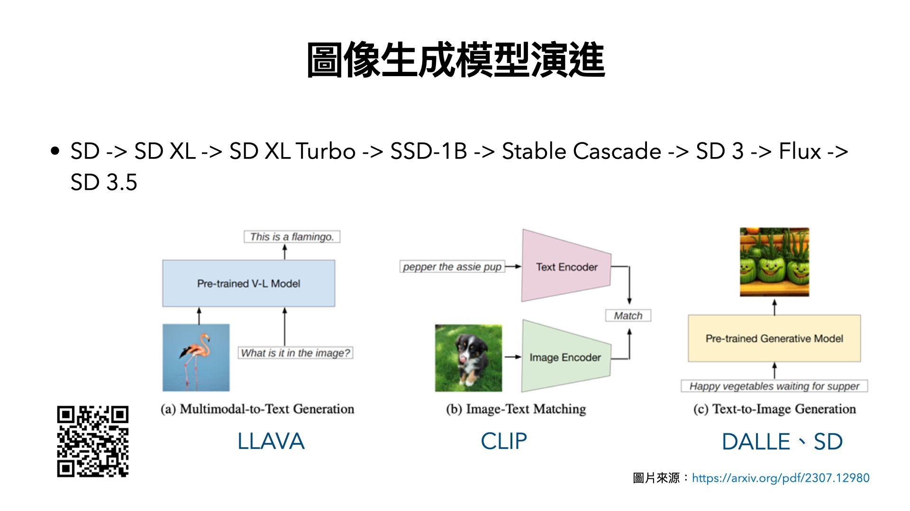
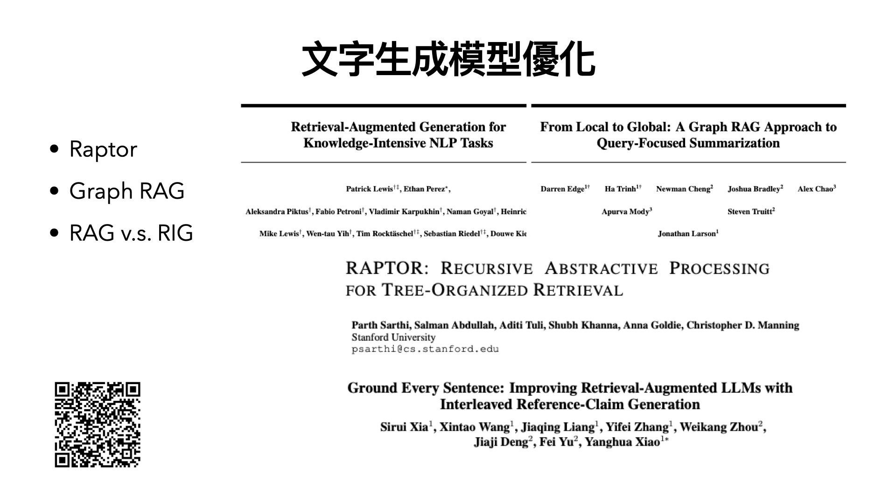
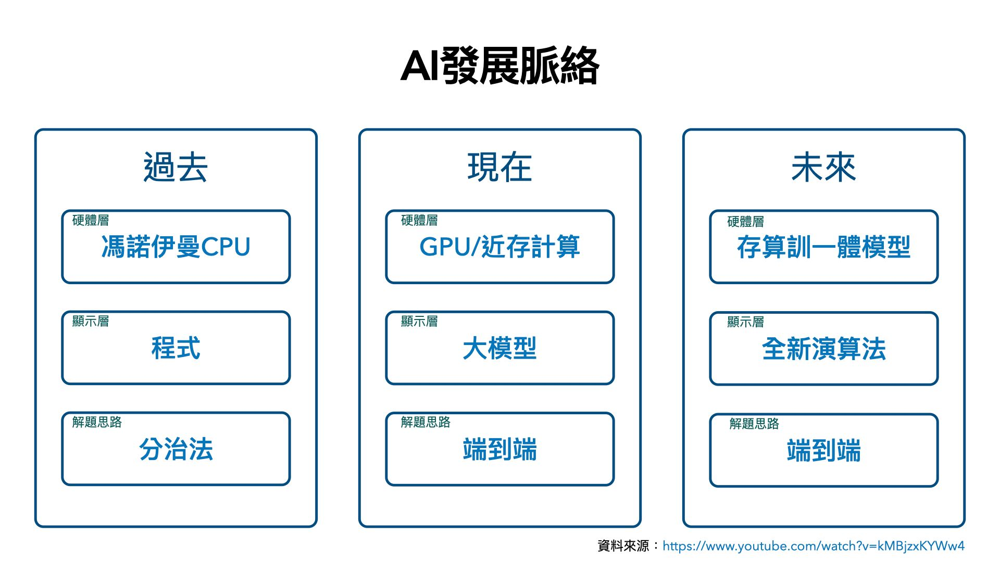
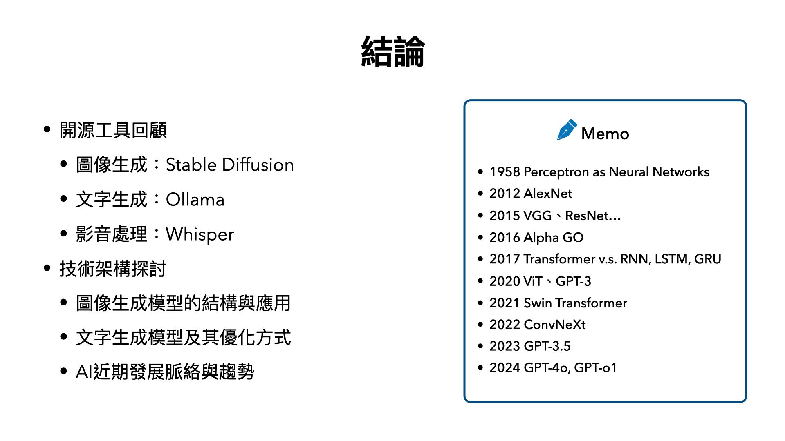

活動連結： [https://reurl.cc/pvE3G8](https://reurl.cc/pvE3G8)

投影片下載： [1bwE5anJ63soo54C080roE1Ye3h1973AV](https://drive.google.com/file/d/1bwE5anJ63soo54C080roE1Ye3h1973AV/view?usp=sharing) 

非常高興週二晚上受邀至台灣人工智慧協會（TAIA）發表短講，介紹了常見的開源工具及技術架構的近期發展，簡單彙整如下：

## 工具參考網站

– gaiworks: [https://genai.works/](https://genai.works/)

– pinokio: [https://pinokio.computer/](https://pinokio.computer/)

## 開源工具包

– 圖像：krita(powered by comfyui) – [https://krita.org/zh-tw/](https://krita.org/zh-tw/)

– 文字：ollama – [https://ollama.com/](https://ollama.com/)

– 影音：whisper – [https://github.com/jhj0517/Whisper-WebUI](https://github.com/jhj0517/Whisper-WebUI)

## 圖像生成模型：

– 種類：GAN、VAE、Flow、Diffusion、Stable Diffusion – [AIGC的前世今生](https://nickzhuang.com/posts/aigc-overview)

– 演進：SD -> SD XL -> SD XL Turbo -> … -> SD 3 -> Flux -> SD 3.5

## 文字生成模型：

– 概念：目前在使用LLM上，為了讓LLM回答的內容更精準，因此可以使用RAG去強化生成的內容，這個概念好比傳遞小紙條給密室裡的人，這個小紙條就是prompt，RAG能讓這張小紙條變成一張A4紙，然後一次把這些紙傳給密室裡的人，密室裡的人就是LLM，因為給定的這些紙，使得問題變得更明確，LLM就能給出更好的答案。

– 優化：除了常見的GraphRAG外，還有使用樹狀結構chunk的Raptor可以參考，這次分享了一個新的觀念：RIG。

RIG（Retrieval-Integrated Generation）是一個和RAG密切相關的概念，但不同之處在於檢索和產生的混合方式。 RIG 沒有將檢索和生成視為不同的步驟，而是將它們更緊密地整合在一起，從而在整個響應生成階段允許檢索過程和生成模型之間動態相互作用。 – [https://reurl.cc/Ordpo9](https://reurl.cc/Ordpo9)

## AI發展脈絡：

過去我們習慣使用分治法的方式解決問題，撰寫程式像是專家系統，在馮諾伊曼的硬體架構底下運行。

現在我們已經使用端到端的方式解決問題，訓練大模型像是LLM，在GPU的顯存的硬體架構下運行，但會有資料搬運的問題。

未來我們還是使用端到端的方式解決問題，利用新型態的演算法，在存儲、計算、訓練同一體的硬體架構下運行，解決資料搬運的瓶頸問題，後續可能會往仿生架構前進。

觀看此處有更詳細的討論： [https://www.youtube.com/watch?v=kMBjzxKYWw4](https://www.youtube.com/watch?v=kMBjzxKYWw4)

## 結論：

人工智慧的探索從1958年展開，那是感知器之於神經網路的論文，期間經歷了幾段的起起伏伏，直到2012年AlexNet問世，深度學習這四個字，才逐漸開始火紅起來，到了2015年，我們開始知道，神經網路的架構，層數越深越好、參數越多越好，這在CNN（卷積神經網路）上的現象尤其明顯，到了2017年Transformer出現，為當今的LLM（大型語言模型）拉開了序幕，隨後研究的ViT、Swin Transformer，直到ConvNeXt，這是一場CNN與Transformer的戰爭，為的是要爭奪圖像分類模型的領導地位：CNN略勝Transformer一籌，近兩年焦點轉向LLM，目前在Hugging Face上已經有許多好用的Foundation Model，GPT持續進化當中。

無論是CNN或是GPT的年代，所謂「端到端」以資料去歸納解法的方式已成顯學，但讓我們疑惑的是，在有效的資料前提下，無腦增加資料量，就足夠了嗎？這種訓練方式與人腦機制有很大的不同，我們可以用少量資料就能學習，還能動態不斷更新，以目前增加數據量及加大模型架構的做法，到底正不正確？好不好呢？這意味著「可以解決問題」跟「解法是否夠好」是兩件不同事情。

我們再把維度拉高，就能追本朔源，思考到以神經元模擬人工智慧的方式，究竟合不合適？仿生學可能是種解法，有來賓提到量子運算，這蠻有啟發性的，究竟結果如何？就待未來驗證吧！

\# 希望有啟發到大家去思考更深層的問題

\# AI的發展真的非常快速
