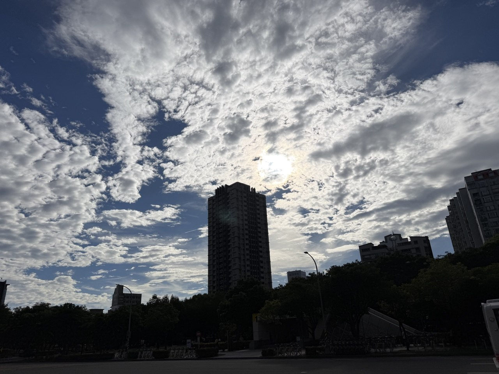

前陣子在公司架設了 GLM-5.2 到機器上後，每個人開始設定可以從內網連線大語言模型，也就是可以透過地端直接問答，不需要雲端算力，因為我們本身就是算力提供商，改變開始了。

體感最大的是寫程式的工作，以往需要2小時的東西，大概10分鐘內就能做完，而且還有多餘的時間寫測試和驗證，這是以往要2~3人的工作，現在1個人就能搞定，還做得又快又好，這會極大化地壓縮 Junior 工程師的需求，以後的 Junior 工程師要求水平會被迫拉升，不然企業雇用你還不如用 AI 協作讓 Senior 去處理就好，不過也可以觀察到 Senior 的 loading 在加重，也要思考配套的調薪措施去處理，把 AI 用的更好的工程師應該要有實質鼓勵才合理。

軟體 Junior 工程師，雖然職缺需求會下降，但後續還是會需要專案管理的需求，類似 AI 專案管理師，旗下會管理多個 AI 專案，定期追蹤，掌握進度，有疑問也可以跟 AI 協作去處理客戶需求，我感覺一部份的 Senior 工程師會跑去做這部分的工作，畢竟有些技術活，PM 可能處理不了，還是要有工程師來處理，別肖想 AI for everyone，現在時間節點還沒到那裏，但體感速度增加20-30%以上是有的。

另外一個有趣的部分，是規劃方面的工作，以往這項目非常曠日費時，因為排程都是以月、季作為級別，如何有效地結合業務端需求與研發的技術未來性結合，是一件有挑戰性的事情，必須要看過許多相關資料，綜合評估才能處理，現在有了 AI，因為是地端自建，所以沒有機敏資料的問題，可以請 AI 提供多個具有潛力的方案，然後主管綜合評估它的提案，選擇一個適合企業當下情境的方案去執行。

請 AI 做事情，還有個好處，不需要去顧慮它的心情，你就直接提出你的需求，它有問題會主動跟你確認，沒有玻璃心、媽寶、通靈等人為溝通的問題，雖然最後一段關卡還是要人來評估判斷，但人力變少的情況下，摩擦力就變小，事情反而可以處理更順暢，不過缺點也不是沒有，一個人可以做的事情變多了，loading 自然會加大，有時候想說等一下它就做好了，結果工時反而變長，不過對於自營企業的我們來說，算是利大於弊。

我現在開 Session 都一次多開3個以上，有時候開到4~5個，同時平行化處理多個事情，非常方便，也很享受這樣的氛圍，上次看統計我的用量還比其他所有人的加總還多，這就是算力無限的瘋狂，算是徹底貫徹了工作狂的偏執。

畫面又回到當初在做以太幣雲礦系統的日子，那時候技術一直推陳出新，就跟現在一樣，每一天都是嶄新的一天，感覺像走在時代的前端，持續接觸最新的技術並實現它，你永遠不知道未來會怎麼樣，當年一個在小房間裡面，獨自探索網路嘗試找到 GPU 超頻方法的我，又再次感到活著的興奮，當初以為要3天結果1個晚上就成功，這樣的模式也帶到了現在的 AI 時代，Transformer 確實改變了我們的生活，只是普羅大眾可能還無法理解，語言模型的運算背後其實消耗了大量的算力，進而衍生出其他的市場需求。

目前開源語言模型還是不斷在更新，並持續逼近閉源模型的效果，甚至有些表現維度上已經超過閉源模型，GLM-5.2、DeepSeek V4 Pro、Kimi K3 都值得關注，或是非紅供應鏈的 Nemotron 3 Ultra、Gemma4（但這些效果都比較差），你可以看到整個 AI 生態系的變化，持續出現更好更快的模型，開源造福眾人並影響整個業態，前陣子我們平台 Sailflow 也開始逐步支援這些開源模型，或許，在不遠的將來，以算力為核心出發的我們，就會改變整個世界。

---

*Nick 2026.07.25 於 台北*
