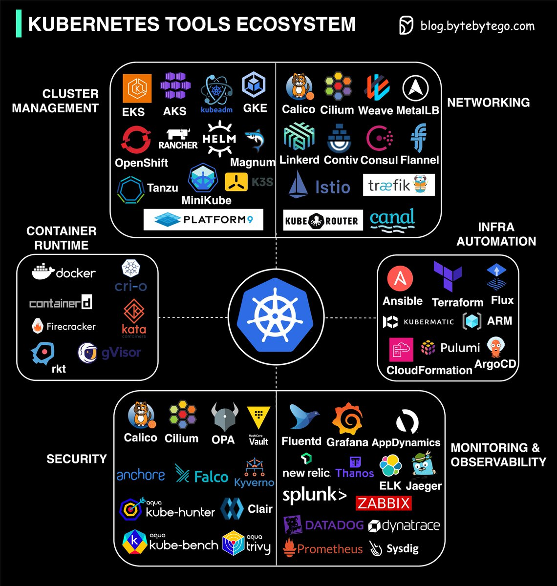

## \[Day21\] k8s實務篇（二）：EKS架設k8s（下）

Author: Nick Zhuang
Type: kubernetes

## 前言

上篇的部分：AWS的基礎設置、創建k8s的控制介面（Yesterday）

下篇的部分：kubectl的安裝與設置、登入EC2的工作節點（Today）

昨天我們看了上篇，今天我們延續 [上篇](https://ithelp.ithome.com.tw/articles/10224889) 的內容，開始介紹下篇的部分，沒看過上篇的朋友，務必先看過。

## kubectl的安裝與設置

這個部分是要將你用的電腦下載kubectl這個套件，並綁定AWS的服務，我們接續著昨天的設定繼續操作。

實務上基本你也不會把minikube的環境和AWS的集群環境混在一起，當初的設計就是先在minikube群集測試，如果沒有問題再上AWS測試，不過在整個流程中還是有些部分可以優化，你可以透過Drone CI/CD的流程去簡化你在Docker內開發、打包、部署等等的工作。

理想的情況下，是把minikube設置在本地電腦，而AWS群集是在區網內的另外一台電腦可見、可操作，提供一個小型的集成開發環境。

對於不太熟悉虛擬機和一般作業系統差異的朋友，可以參考： [第二天的內容](https://ithelp.ithome.com.tw/articles/10216560)

因為筆者之前在mac OS的機器上已經裝了minikube，為了保證環境的隔離性，就另外裝了VirtualBox，並在裡面新增了Ubuntu的環境，因此接下來的操作，都是在該環境內進行的，請特別留意。

### VirtualBox的相關設置

#### 開始之前的設置

下載VirtualBox桌面版，請參考 [這裡](https://www.virtualbox.org/wiki/Downloads)

新增Ubuntu到VirtualBox中，可以參考 [這裡](https://www.wikihow.com/Install-Ubuntu-on-VirtualBox)

我們不會透過這個圖形介面操作，因為在mac環境的指令要貼過去很麻煩，所以我們會換個做法：

利用圖形化介面設置ssh

直接透過ssh連到ubuntu操作

底下示範操作：

#### 確認ubuntu的ip

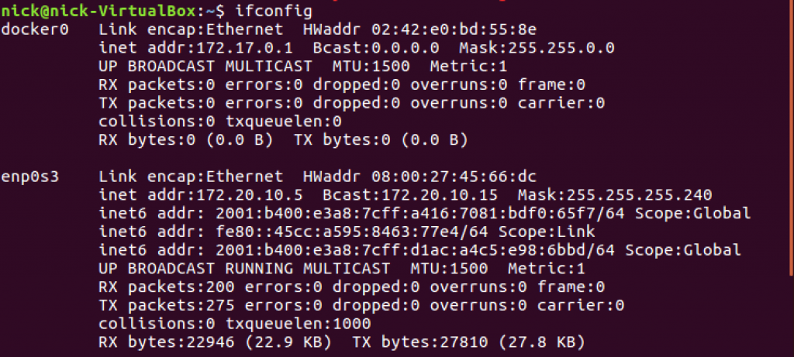

可以注意到ip是172.20.10.5，而網路介面是enp0s3

#### 將ssh的service安裝到ubuntu

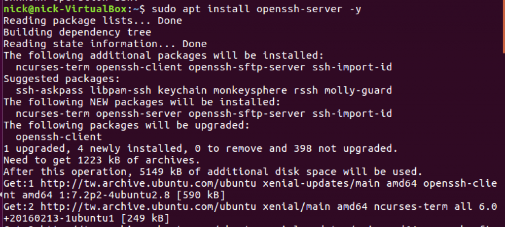

#### 確認ssh的service狀態

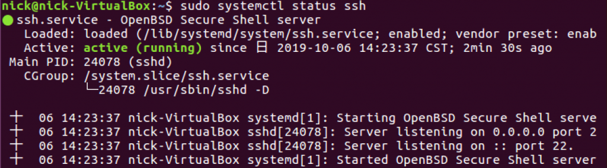

OK，確認無誤，我們先把Ubuntu關掉

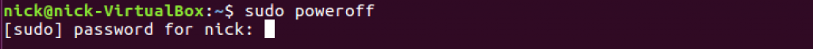

#### 設置VirtualBox的網路

網卡一：

網卡二：

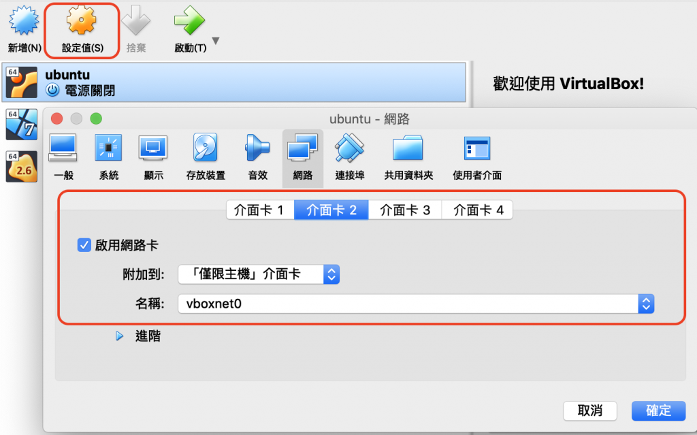

接著啟動VirtualBox，直接把那個畫面縮小

我們從命令列登入

\> Loading Bash code...

​

OK，可以用了，相信有人注意到這個IP是跟minikube的ip是一樣的，這個IP是可以改的，設定靜態IP，可以參考 [這裡](http://reneeciou.blogspot.com/2012/04/sshoracle-vm-virtualbox-ubuntu.html)

### 安裝kubectl到Ubuntu

以下皆是在虛擬機的ubuntu操作喔！

接著就要延續上個章節的內容了，我們這邊要：

#### 從AWS安裝kubectl

\> Loading Bash code...

​

這會花點時間，取決於網路速度，我們等它一下，好了進到下一步

#### 賦予kubectl執行權限

\> Loading Bash code...

​

#### 環境設定

\> Loading Bash code...

​

#### 檢查kubectl版本

\> Loading Bash code...

​

### 安裝 aws-iam-authenticator

#### 下載程式

\> Loading Bash code...

​

#### 賦予該程式執行權限

\> Loading Bash code...

​

#### 環境設置

\> Loading Bash code...

​

#### 檢查程式

\> Loading Bash code...

​

#### 檢查Token

這邊我們透過剛安裝的authenticator去驗證，###的部分在 [之前](https://ithelp.ithome.com.tw/articles/10224506) 下載的accessKeys.csv裡面

\> Loading Bash code...

​

接著使用這個檔案透過API取得Token

\> Loading Bash code...

​

#### 安裝awscli並驗證

至少要1.16.156以上的版本，下面要設置會比較容易～

\> Loading Bash code...

​

驗證eks-cluster的設置

\> Loading Bash code...

​

#### 設置kubectl的config

將<>範圍的字串用EKS上的cluster對應資訊抽換掉

\> Loading YAML code...

​

好了之後，檢查下

\> Loading Bash code...

​

OK，設置到這邊就結束囉！我們看一個Topic～

## 登入EC2的工作節點

前一段我們已經把集群架設起來了，接著我們要做的事，就是要把Work Node加到集群中。

先回到AWS Management Console，進到CloudFormation

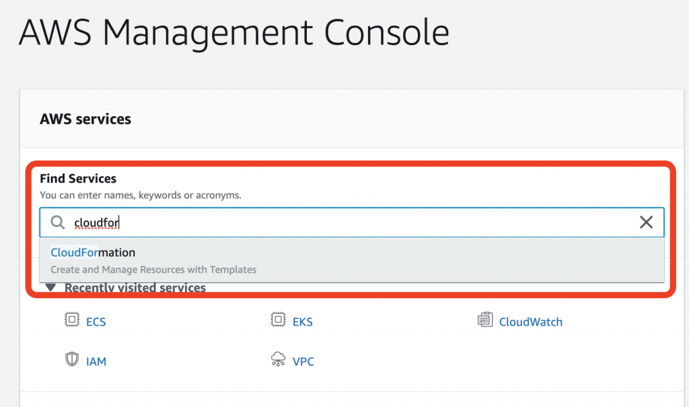

接著新增一個Stack，這個Stack是Node Group

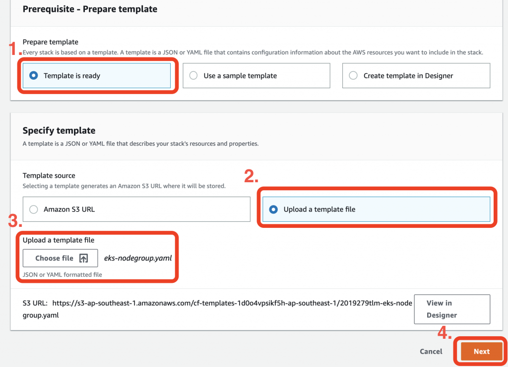

其中的eks-nodegroup.yaml可以從 [這裡](https://www.dropbox.com/s/4arr5xa6w2wovbw/eks-nodegroup.yaml?dl=0) 下載

再來是一些其他參數的設定

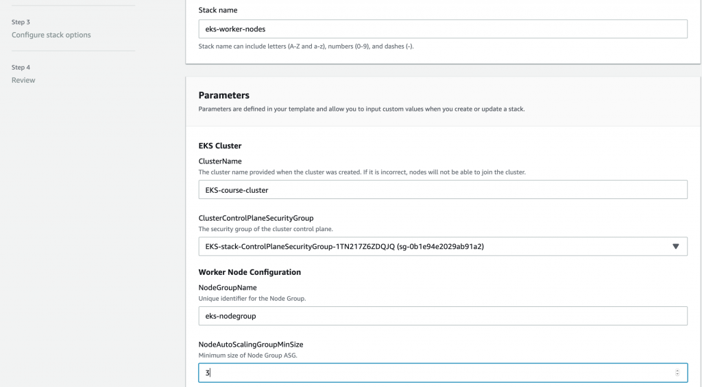

注意到AMI的部分，這個需要最佳化設定，參考 [這裡](https://docs.aws.amazon.com/zh_tw/eks/latest/userguide/getting-started-console.html)

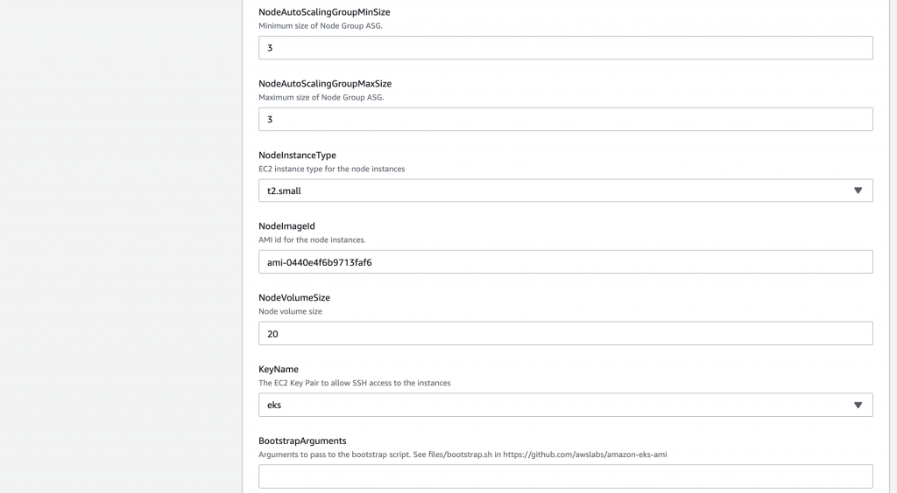

三個Subnet都要放上去

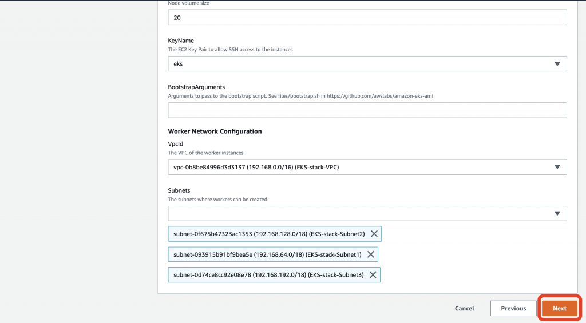

大致這樣，好了下一步，按Next

後面只是總覽，不用改，直接Create Stack就好

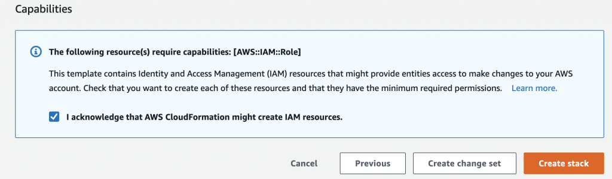

要稍等一下，好了之後我們去看一下EC2，那邊會有三台機器開起來

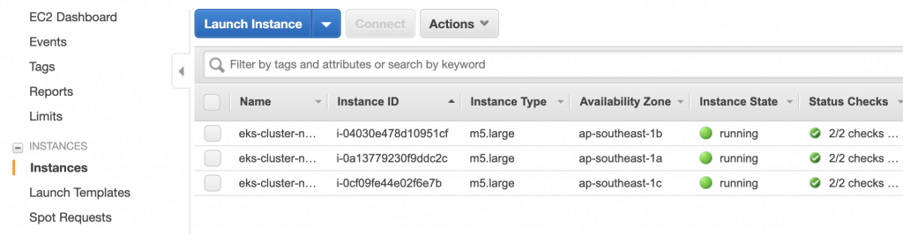

我們到Security Group那邊的NodeGroup去加個SSH的設置

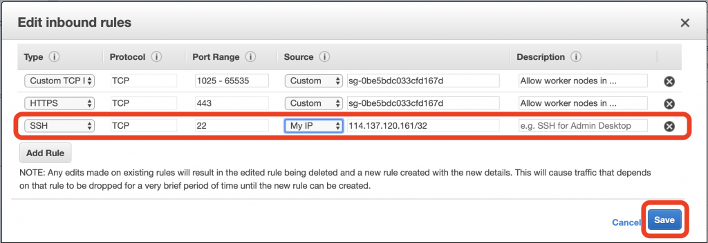

檢查Instance的IP

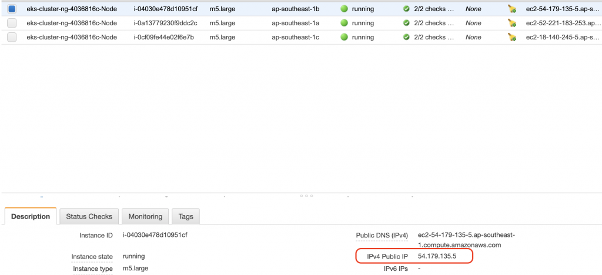

這樣的話，就能利用前面的eks.pem連進去囉

\> Loading Bash code...

​

我們檢查下節點狀態

\> Loading Bash code...

​

看樣子還沒結束，要在k8s集群裡面改ConfigMap才能確保節點順利加入

\> Loading YAML code...

​

其中<<role-arn-from-previous-step>>要換成下方反白內容

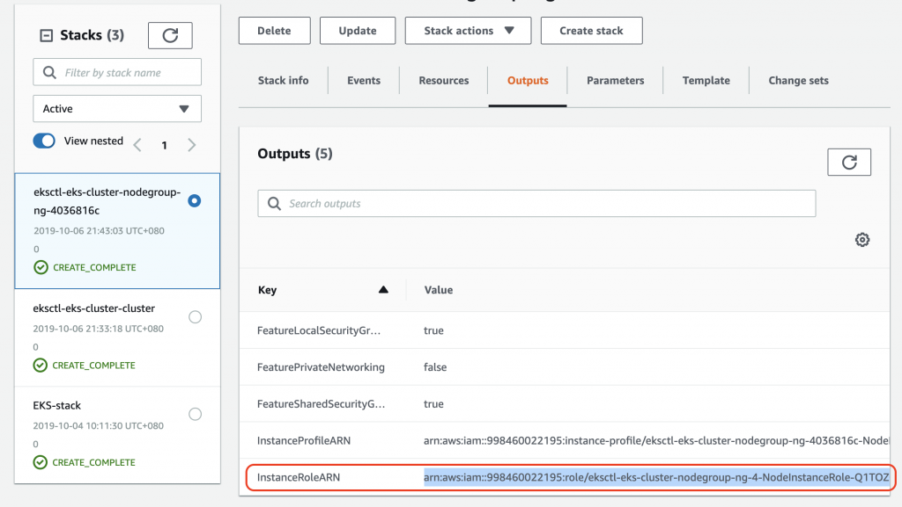

好了apply一下，官方有說這個檔案的其他內容最好不要亂動

\> Loading Bash code...

​

最後我們可以看到集群的節點狀態

\> Loading Bash code...

​

OK，雲端AWS的集群設置完畢了！

## 小祕技：用eksctl架設集群

如果你覺得這樣設置實在累到爆，筆者傳授必殺技給你

我們其實可以直接利用eksctl設置，讓我們感受一下

### 下載並安裝eksctl

\> Loading Bash code...

​

### eksctl架設群集

創建一個新群集，名稱是eks-cluster，3個節點，使用新加坡的網域

\> Loading Bash code...

​

這會花一點時間，大概要20分左右

前面不提的原因是，如果一開始就這樣設置了，那麼發生問題的時候，因為AWS元件熟練度不足，會要花更多時間排錯^\_^

## 小結

今天我們看到了雲端AWS集群的架設方式，下卷結束了，整體來說介紹應該算蠻完整的，我們也學習到了eksctl初步的使用，它可以讓我們快速的架設群集，跟Kops速度上感覺差不多，當然目前感覺Kops的控制項還是比較多的，明天開始會在雲端的群集操作了，我們可以開始看到雲端和區網的不同，加油！明天見了！

## 參考資料

[EKS升級k8s](https://docs.aws.amazon.com/zh_tw/eks/latest/userguide/update-cluster.html)

[AWS Management Console](https://docs.aws.amazon.com/zh_tw/eks/latest/userguide/getting-started-console.html)

[VirtualBox使用SSH](http://reneeciou.blogspot.com/2012/04/sshoracle-vm-virtualbox-ubuntu.html)

[AWS安裝kubectl](https://docs.aws.amazon.com/zh_tw/eks/latest/userguide/install-kubectl.html)

[AWS安裝iam認證器](https://docs.aws.amazon.com/zh_tw/eks/latest/userguide/install-aws-iam-authenticator.html)

[AWS驗證用戶角色](https://docs.aws.amazon.com/zh_tw/eks/latest/userguide/add-user-role.html)

[AWS架設群集排錯方式](https://docs.aws.amazon.com/zh_tw/eks/latest/userguide/troubleshooting.html#unauthorized)

[eksctl的安裝使用](https://docs.aws.amazon.com/zh_tw/eks/latest/userguide/eksctl.html)

[\\
\\
k8s總結：架構整合、圖表整理\\
\\
October 15, 2019](https://nick-zhuang.notion.site/k8s-1e9d2b687266802585b4c4a9ae6be18d?pvs=25)

[\\
\\
k8s集群篇：HA、Federation\\
\\
October 14, 2019](https://nick-zhuang.notion.site/k8s-HA-Federation-1f0d2b68726680bc9dd5dd7b27b4f749?pvs=25)

[\\
\\
k8s應用篇（二）：EBS和EFS的使用\\
\\
October 13, 2019](https://nick-zhuang.notion.site/k8s-EBS-EFS-1f0d2b68726680bd9a34c99d63b844b7?pvs=25)

[\\
\\
k8s應用篇（一）：Helm部署apps、HPA和CA\\
\\
October 12, 2019](https://nick-zhuang.notion.site/k8s-Helm-apps-HPA-CA-1f0d2b6872668062a919dd160ad5a85f?pvs=25)

[\\
\\
k8s管理篇延伸與EKS（二）：Resource Quota、Namespace、RBAC\\
\\
October 11, 2019](https://nick-zhuang.notion.site/k8s-EKS-Resource-Quota-Namespace-RBAC-1f0d2b687266807f9ccfffcabc81da74?pvs=25)

[\\
\\
k8s管理篇延伸與EKS（一）：Service Discovery、Dashboard、Monitoring\\
\\
October 10, 2019](https://nick-zhuang.notion.site/k8s-EKS-Service-Discovery-Dashboard-Monitoring-1f0d2b687266803a8955ef8f4d794ddd?pvs=25)

[\\
\\
k8s進階篇延伸與EKS（二）：Scheduling\\
\\
October 9, 2019](https://nick-zhuang.notion.site/k8s-EKS-Scheduling-1f0d2b68726680bd90ffc3629c6e5a76?pvs=25)

[\\
\\
k8s進階篇延伸與EKS（一）：Ingress、ELB、Service\\
\\
October 8, 2019](https://nick-zhuang.notion.site/k8s-EKS-Ingress-ELB-Service-1f0d2b6872668013bf47dfa5b607e559?pvs=25)

[\\
\\
k8s基礎篇延伸與EKS：Pod、Label、Probe、Scaling\\
\\
October 7, 2019](https://nick-zhuang.notion.site/k8s-EKS-Pod-Label-Probe-Scaling-1f0d2b68726680c99b41ca046abf72b8?pvs=25)

[\\
\\
k8s實務篇（一）：EKS架設k8s（上）\\
\\
October 5, 2019](https://nick-zhuang.notion.site/k8s-EKS-k8s-1f0d2b6872668041ab6fea00e8dd55f1?pvs=25)

[\\
\\
k8s上雲端之路：AWS之蓄勢待發：EOO\\
\\
October 4, 2019](https://nick-zhuang.notion.site/k8s-AWS-EOO-1f0d2b68726680ac80b5fcb63700f600?pvs=25)

[\\
\\
k8s之管理篇延伸：兩個H的小故事：Harbor與Helm\\
\\
October 3, 2019](https://nick-zhuang.notion.site/k8s-H-Harbor-Helm-1f0d2b687266804793dbf80040d218f9?pvs=25)

[\\
\\
k8s管理篇（三）：User Management、RBAC、Node Ｍaintenance\\
\\
October 2, 2019](https://nick-zhuang.notion.site/k8s-User-Management-RBAC-Node-aintenance-1f0d2b687266803096d7f86170e1ca3c?pvs=25)

[\\
\\
k8s之PV小整合：Pod、Deployment、Service、Job與PersistentVolume\\
\\
October 1, 2019](https://nick-zhuang.notion.site/k8s-PV-Pod-Deployment-Service-Job-PersistentVolume-1f0d2b68726680f1b69eda34aa091f98?pvs=25)

[\\
\\
k8s管理篇（二）：Resource Quota、Namespaces\\
\\
September 30, 2019](https://nick-zhuang.notion.site/k8s-Resource-Quota-Namespaces-1f0d2b687266804a9236faaaaeefe4cb?pvs=25)

[\\
\\
k8s管理篇（一）：Monitoring、Job、CronJob\\
\\
September 29, 2019](https://nick-zhuang.notion.site/k8s-Monitoring-Job-CronJob-1f0d2b68726680d0995bfe1b9a6008a0?pvs=25)

[\\
\\
k8s進階篇（四）：Affinity and Anti-Affinity、Taints and Tolerations\\
\\
September 28, 2019](https://nick-zhuang.notion.site/k8s-Affinity-and-Anti-Affinity-Taints-and-Tolerations-1f0d2b6872668080b20af8cb58ba6022?pvs=25)

[\\
\\
k8s進階篇（三）：StatefulSet、DaemonSet\\
\\
September 27, 2019](https://nick-zhuang.notion.site/k8s-StatefulSet-DaemonSet-1f0d2b68726680c69dadd98cacafb481?pvs=25)

[\\
\\
k8s進階篇（二）：Ingress、Volume、PodPreset\\
\\
September 26, 2019](https://nick-zhuang.notion.site/k8s-Ingress-Volume-PodPreset-1f0d2b687266806b92fefb8bd3dbe589?pvs=25)

[\\
\\
k8s進階篇（一）：Service Discovery、ConfigMap\\
\\
September 25, 2019](https://nick-zhuang.notion.site/k8s-Service-Discovery-ConfigMap-1efd2b68726680fd8e10f382478dc3cf?pvs=25)

[\\
\\
k8s基礎篇（二）：Deployment、ReplicaSet、Service、Secrets\\
\\
September 24, 2019](https://nick-zhuang.notion.site/k8s-Deployment-ReplicaSet-Service-Secrets-1ead2b687266802ea4dbc285f67c5b63?pvs=25)

[\\
\\
k8s基礎篇（一）：Pod、Label、Health check、Scaling\\
\\
September 23, 2019](https://nick-zhuang.notion.site/k8s-Pod-Label-Health-check-Scaling-1e9d2b687266807487bedc9d924465ac?pvs=25)

[\\
\\
想想我們為何而來：一個完整DevOps開發流程的十二個要素\\
\\
September 22, 2019](https://nick-zhuang.notion.site/DevOps-1e9d2b68726680f59fe8d5f37bc29e50?pvs=25)

[\\
\\
淺談k8s架構之二：什麼是Object？什麼是Abstraction？有何不同？\\
\\
September 21, 2019](https://nick-zhuang.notion.site/k8s-Object-Abstraction-1e9d2b68726680c79b63f285c9ff6992?pvs=25)

[\\
\\
淺談k8s架構之一：Node是什麼？Master與Slave有何不同？\\
\\
September 20, 2019](https://nick-zhuang.notion.site/k8s-Node-Master-Slave-1e9d2b68726680d19265f238cb174616?pvs=25)

[\\
\\
碼頭工的日常與舵手的逆襲：Docker與k8s常用指令集比較\\
\\
September 19, 2019](https://nick-zhuang.notion.site/Docker-k8s-1e9d2b68726680049139f77c9ae39021?pvs=25)

[\\
\\
k8s的小型測試環境：minikube安裝與使用，簡易驗證yaml的正確性\\
\\
September 18, 2019](https://nick-zhuang.notion.site/k8s-minikube-yaml-1e9d2b68726680ec9e4cdffa7af1c0fe?pvs=25)

[\\
\\
一日碼頭工：快速Docker複習\\
\\
September 17, 2019](https://nick-zhuang.notion.site/Docker-1e9d2b6872668018a774df1c34ddc7fb?pvs=25)

[\\
\\
k8s初探＋簡介\\
\\
September 16, 2019](https://nick-zhuang.notion.site/k8s-1e9d2b68726680b4b6a5d53ee88014fb?pvs=25)