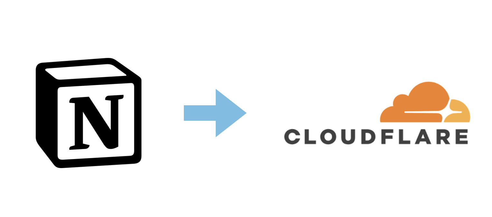
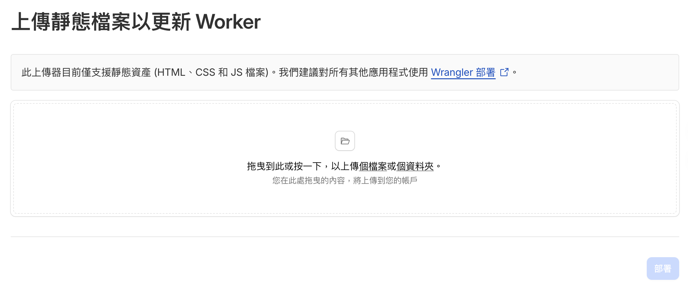
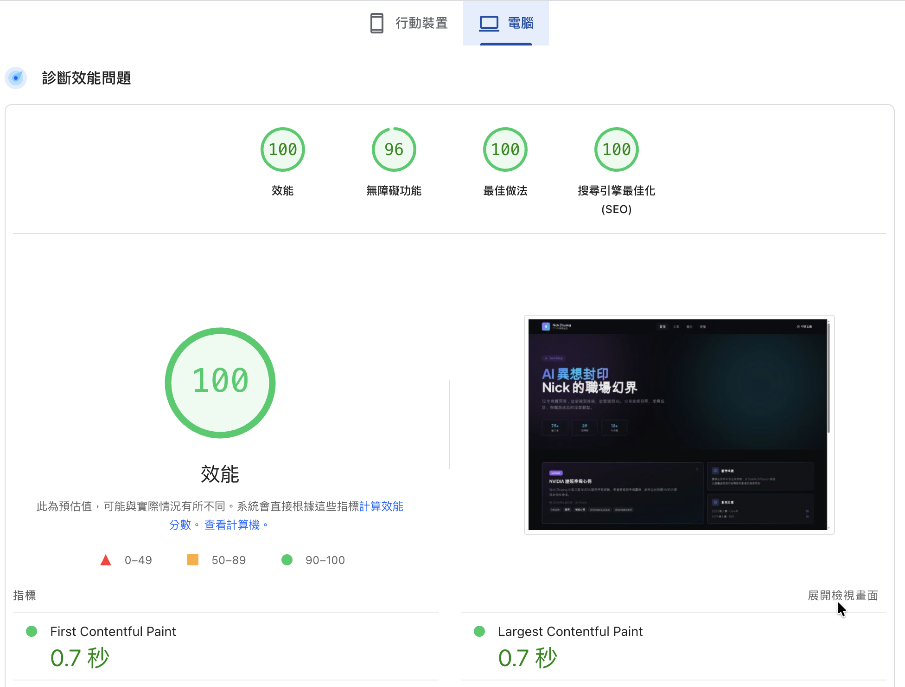

去年，我將網址從 Wordpress 遷移到 Notion，是為了避免費用及備援的問題，但其實回顧這整年，問題蠻多的（哎唷喂呀

首先，因為是透過 Frution.js 跳轉的關係，唯一能加進去 Google 索引的只有網址本身而已，也就是 nickzhuang.com，其他設定的全都無效，Google 的索引系統不接受這種跳轉方式，在 GSC 上幾乎是慘不忍睹。

其次，轉換之後，因為不是直接把網址跟對應的位置映射到網路上，導致流量大跌，幾乎歸 0，這一年下來幾乎沒有什麼流量，不過因為這半年很多時間都在準備考試，所以也沒什麼產出，倒也無傷大雅，但流量長期以往我覺得還是硬傷，決定近期要做些改變。

再者，Notion 上的模板寫部落格，還是有點綁手綁腳，顯示的方式有些受限，其實我會寫前端，只是之前都懶得改，覺得要維護太麻煩，但那個介面樣式，久了還是無法接受，於是決定「打掉重來」，用「真前端」顯示的頁面。

這樣的好處，就是可以自行決定所有樣式，想怎麼捏就怎麼捏，捏出你想要的樣子都可以，唯一的缺點就是要自行維護，好家在現在 AI 極度方便，可以利用對應的服務直接產生你要的介面，後續維護也只要講出你的需求，AI 都可以幫你修改。

現在要運用現成的 APP 去生成網站，有兩個方式：
1. readdy：https://readdy.ai/
2. replit：https://replit.com/

你只要打字跟他講你要的風格，還有網站的用途，它就可以幫你自動生成。

實測過後，readdy 比較適合白底風格，replit 比較適合黑底系列的，我最後是選 replit，一來是他有免費額度（每天 3 次），程式碼還可以直接下載（當然你也可以選擇直接託管在他的網站上，可以指定域名）。

後續要維護的話，可以用Github Copilot（每月也有免費額度，想用其他付費模型也可），我是把專案設定在 VS Code 上，有想修改的就直接呼叫 Copilot 修改，文章用 Markdown 格式撰寫（利於 AI 分析調整）。

決定好這些步驟以後，再來就是詠唱咒語啦！下了幾個提示詞後，框架會自動生成，現在這些網站生成服務為了保證他的品質穩定性，預設會直接套用模板（像是：前端框架 React 跟 TypeScript，後端預設會套 Postgresql），不過這些技術細節都不用跟它講，你只要跟他說你這個網站是要拿來做啥的就行。

這是我用的提示詞：

```
參考https://nickzhuang.com/1ccd2b68726680d1887ae04ad476f98b
的內容，我想要重構一個相同內容的網站，但是把風格改成：
現代、簡約、AI、科技感的風格
這是一個部落格網站，分享我技術的職涯分享
```

你如果像確認一些問題，以便更好的呈現畫面，想要問我的話，可以發問

現在的模型表現體感越來越好，應該是 Harness Engineering 設計有優化，就是透過框架先確認用戶意圖，然後按照對應的需求套用對應的 SOP，輸出就會比較穩定。

生成框架後，我就陸續透過每天的免費額度，逐步搬遷資料到新網站上，我是透過 replit 去讀取原本的網站內容，讓它自動化地複製貼上，而且還能自動幫你加其他的說明欄位，像是預計的閱讀時間、文章自動貼標籤等。最後整體框架內容確認差不多後，就把程式碼下載到我自己電腦上，使用 Copilot 去精修內容，像是文字排版、介面樣式。

託管網站到 Cloudflare 的方式是，將搬遷的內容存在自己的電腦上的那些程式碼，下指令 pnpm build，就會幫你生成網頁，預設會在一個資料夾（dist或是out之類），在這底下的就是你的靜態網站內容，直接將其上傳到 Cloudflare 上的 Pages 上即可。



因為我要的格式只有部落格，都是靜態內容比較單純，如果是要儲存一些資料，像是填入表單的話，就需要另外處理，可以用 Google App Script 或是自行串資料庫，這個就要另外研究了，Cloudflare 要用後端儲存資料的話，可能會有另外的流量費用。

縱觀整體，歷經了 2 週搬遷與修改格式，總算大功告成，後續也不用再轉移了，因為現在也把網站內容加入 Github 處理，就算以後這個服務要收費，我也可以直接無痛切換，算是了了一個多年來的心願，現在新增文章就是本地寫完 Markdown，檢查格式無誤就能直接打包上傳，算是可喜可賀。



目前初步觀察 GSC 的結論，Google 索引正常，之前的問題也都消失了，如果你有自架網站的需求，試試這個方法，AI 應用遍地開花的時代，已經悄然而至，任何天馬行空的想法，都有機會可以實現。

Nick 2026.04.18 於 新北市

\# 全文無使用 AI，純手打，沒有加料成分
