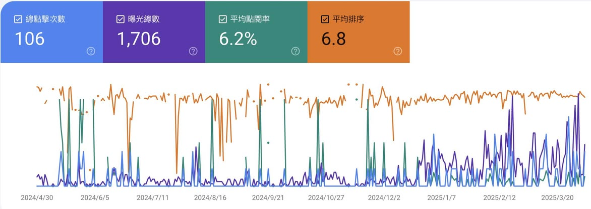

— 偉大的事情，常常源自於一個單純的想法--By 某人

## 前言

自從去年出書以後，有感除了書籍內容以外，在網路上發表的文章較少，期許自己能夠用更有效率的方式去分享知識，於是興起了自建部落格的想法。

一開始想說要寫文章，就直接架設Wordpress的網站就行，但，這只是開始而已。

## 發文要素

要能夠成功地讓「文章俱樂部」開張，有以下3個關鍵步驟：

1. 買域名：必須要有Domain name，別人才能透過這個名字找到你的部落格

2. 託管區：必須要有放置Wordpress的機器，才能在上面跑Wordpress的應用程式，我選了Bluehost

3. 主題包：Wordpress有免費與付費的主題包，各有優缺點，我先買了一個付費版的，花了一點時間挑版型

雖然Bluehost初次儲值的金額很便宜，但其實這一年用下來，最大的感觸就是只要切到某一頁，再切成其他頁，網頁就會整個掛掉，這件事情困擾我很久，後來姑且的解法是每次寫完文章就備份，不行就倒回，非常麻煩。

後來找了幾個有自己經營託管區的廠商，回饋是說原因是使用免費初次儲值的方案，算是Bluehost在入門版留下的Bug

就這樣陸陸續續壞了好幾次，人有時候就是會剛好忘記切到哪一頁會掛掉，也間接地消磨我分享的動力。

很快地就過了一年了，中途其實有分享不少內容，但不見得都在部落格上，散落在各處的公開平台上；例如，FB、Linkedin、鐵人賽等等，我決定要將各處的文章全部集中起來，用一個 [nickzhuang.com](https://l.facebook.com/l.php?u=https%3A%2F%2Fnickzhuang.com%2F%3Ffbclid%3DIwZXh0bgNhZW0CMTAAYnJpZBExejNhZW1EZFBVRDluQnl4VwEe0bCdusXDKHinAZ7-HRfqsPj-iyHOoSD4cV-KRtR6dQZQHjvemQekz4VQvgI_aem_Eljct4d217cGMxOESiwwpg&h=AT1rdaUsmSS4QRlgTvL3ypCu7k4ZyFOipunXqrHLzwWXHXJTvgqsR3ZwZ1ZqjvZMgBqTTXk1quuU99Y8W6ad3tWnubgnmhu3_Jl6UtJecvJVmo2WiEb7GLzXuSmyn9sPxwjUvCyO5HrqUst6D-suBjV10WQUw2ie9OE&__tn__=-UK-R&c[0]=AT3qos8cgQoPkXMaguM91oJqr-pIrGxMbU4xAUackhraZYHAx8NuqhW6fqOGFG1a3PSIAEzcqdgEjmEaaC3JJuaSDr_ZNm3zo18k_pNaidR6RJ2yGuTSOVDAwtTGl1WSKunz93cRmguDsOYt8fekpwHMXx60Uyo9V2vlK2To5cZcFJEWc4YgSDaO3yBcyJ8qD0a04Vdqq5kVP5mxQBruzNvc) 解決掉。

那問題來了：離開Bluehost後，要去哪呢？我不想付這種託管平台，一開始價格就沒很親民了，我想尋找更具有性價比的方案。

## Notion寫部落格優勢

最後找到的解法是：用Notion寫，然後再將其公開的網址映射到 [nickzhuang.com](https://l.facebook.com/l.php?u=https%3A%2F%2Fnickzhuang.com%2F%3Ffbclid%3DIwZXh0bgNhZW0CMTAAYnJpZBExejNhZW1EZFBVRDluQnl4VwEecIPrg1zruVSytveIsSLlzfS5sjPjCiKB2foSZ0W-5bQtdeb0w0-j-it-86s_aem_LgOATMU825D7bJv2YRPfeg&h=AT1rdaUsmSS4QRlgTvL3ypCu7k4ZyFOipunXqrHLzwWXHXJTvgqsR3ZwZ1ZqjvZMgBqTTXk1quuU99Y8W6ad3tWnubgnmhu3_Jl6UtJecvJVmo2WiEb7GLzXuSmyn9sPxwjUvCyO5HrqUst6D-suBjV10WQUw2ie9OE&__tn__=-UK-R&c[0]=AT3qos8cgQoPkXMaguM91oJqr-pIrGxMbU4xAUackhraZYHAx8NuqhW6fqOGFG1a3PSIAEzcqdgEjmEaaC3JJuaSDr_ZNm3zo18k_pNaidR6RJ2yGuTSOVDAwtTGl1WSKunz93cRmguDsOYt8fekpwHMXx60Uyo9V2vlK2To5cZcFJEWc4YgSDaO3yBcyJ8qD0a04Vdqq5kVP5mxQBruzNvc) 上面。

這樣有幾個好處：

1. 文章直接雲端存，有備份

2. 遠離誤換頁當掉問題

3. Notion也有模板可以套用，類似Wordpress中的主題

4. 平常寫技術文件就是用Notion，無縫接軌

用Notion寫很輕鬆，加上尋找模板的時間，大概才花2小時不到，就把之前在網站上的內容轉到上面。

再來就是關鍵了，要如何把域名綁定他給你的憑證，這要用到Cloudfare的worker。

## Cloudfare的worker

Cloudfare託管個人的網站，除了可以防DDos外，還有些基本的資安防護，一個站點是免費的。

worker.js裡面，可以自行修改參數以符合自身域名的需求。這個程式主要的用途是幫助轉址，將 Notion 上的對外公開網址，映射到 [nickzhuang.com](https://nickzhuang.com/?fbclid=IwZXh0bgNhZW0CMTAAYnJpZBExejNhZW1EZFBVRDluQnl4VwEe0W5OCC2GNVHjIahcyszxoCXi0aUczsShdCErb2vBl9n2IDNlWqe-hlFcI2Y_aem_S2D8cJZHqQZNSMNNjjHtCw) 上。

做過SEO的都知道，要能讓你的網站出現在搜尋結果上，那才有流量，也才有意義，代表你寫的內容能真的被看見，其中一個重點是要有sitemap.xml，主動回報給Google的搜尋引擎，讓它知道有這個網站。

好消息是，worker.js裡面，可以自行設定你要的sitemap.xml內容，讓對應的頁面，可以納入搜尋的索引中。

我還解掉一個有意思的問題：如何在新的網站上也能運用舊網站的URL去連接到對應的頁面？

像我因為有些文章已經存在搜尋引擎的結果中，所以我想保留這些舊版的URL，這樣在Google搜尋出的結果中，原有的內容還是可以正確地呈現。

於是乎我改寫了worker.js，也讓它有這樣的功能。

所以結論來說，worker.js有三個功能：

1. 轉址到購買的域名上

2. 生成sitemap.xml

3. 保留舊址的搜尋結果

最後是費用結算：

域名：一年約500

託管：0元

Cloudfare：0元

總計：500 + 0 + 0 = 500

一年只要500塊，你就可以有自己的名稱部落格，是不是超棒？

目前我的網站還沒什麼流量，有4篇文章，後續會陸續轉移，預計會到80篇以上，大多數都是講Infra跟AI相關技術的內容，偶爾會有些職涯分享，之後新增文章會以這裡為主，有興趣歡迎來逛逛。

關於worker.js的程式碼，我公開在Github上，取之於開源，回饋於開源，覺得有幫助的話，歡迎點贊分享，連結如下：

1. Notion的範本： [https://reurl.cc/YYVpVa](https://l.facebook.com/l.php?u=https%3A%2F%2Freurl.cc%2FYYVpVa%3Ffbclid%3DIwZXh0bgNhZW0CMTAAYnJpZBExejNhZW1EZFBVRDluQnl4VwEe6nUJEZ_3Ygg1fYqkXjfySpo2KYPRgyn7RZiD8KjLI8dP15Rj6wcOYclq2uA_aem_cOI0NE0H1xSSow0zI1W9fw&h=AT3NmGHVnJSXdYvrhZxXIIk19t9rDU7Fruhl-0wWWxYAQgUftQC_HZGP60lBGJe9_wrt-mSTPydEOT8Z7Chq1N5ynAZb40qLXKIFY31bGVDv1Pxx9TeYJRAf5du0A5yCnN3ExWc-bUqaFbb-dlTwJAsrT_CkTFioeOU&__tn__=R]-R&c[0]=AT0lDL1opSNhguO07uhLxVBcFKS9s-RmTyItBZHn5ONM5_B48nAWZQ0ty44gJMhFTKo1WOOLALIrkCmD8s4UVYk2o8VXV8_bQjIPL0r2s_0dkFr7KWh_szA-IcIjBroRu8vC_6vC_sI08V4uRaxijzehza2dH0QCN2lJ-GeUI-Oq2sYagzMxM2LaprqNCE4)

2. Notion綁定域名： [https://reurl.cc/4Ljnr3](https://reurl.cc/4Ljnr3?fbclid=IwZXh0bgNhZW0CMTAAYnJpZBExejNhZW1EZFBVRDluQnl4VwEe0bCdusXDKHinAZ7-HRfqsPj-iyHOoSD4cV-KRtR6dQZQHjvemQekz4VQvgI_aem_Eljct4d217cGMxOESiwwpg)

3. 我的worker.js： [https://reurl.cc/M34VO4](https://reurl.cc/M34VO4?fbclid=IwZXh0bgNhZW0CMTAAYnJpZBExejNhZW1EZFBVRDluQnl4VwEe0bCdusXDKHinAZ7-HRfqsPj-iyHOoSD4cV-KRtR6dQZQHjvemQekz4VQvgI_aem_Eljct4d217cGMxOESiwwpg)
