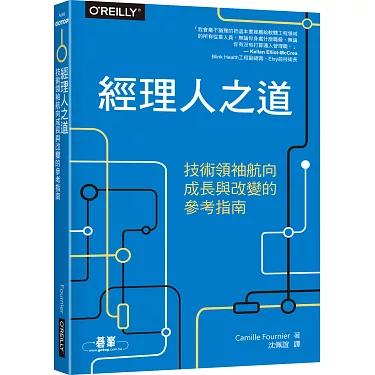

《經理人之道：技術領袖航向成長與改變的參考指南》為技術領域的領導者提供了全面而實用的指導，涵蓋了從個人成長到團隊建設、從變革管理到創新推動等各個方面的內容。這本書不僅僅是一本管理手冊，更是一個能夠幫助技術領袖在不斷變化的環境中保持領先地位的寶貴資源。

這本書非常推薦給軟體從業人員，它很好地指出了在各個不同階段的詳細參考準則，其實一切的管理都是從自身開始，剛入行的時候，先學會一門程式語言，隨著時間的推移不斷精進，到有一定程度的經驗後，開始可以當小組長帶人，有了徒弟，又再隨著時間的推進，開始可以帶主管，按公司規模最高可以升到技術長（Chief Techology Officer, CTO）。

一般來說至少能升到資深工程師，也就是：Engineer -> Senior Engineer，後續可以細分為兩類：

純技術路線： Tech Lead -> Staff Engineer -> Principle Engineer

管理職：Manager -> Senior Manager -> Director -> VP -> CTO

以我自己本身為例，先是做了3年的Python軟體工程師，後面逐步往上晉升，先升到資深工程師，5年後升到Tech Lead，帶5人的小團隊，跑敏捷開發，目前在AI新創擔任技術長(CTO)一職，回想起來這本書真的幫助蠻大的，推薦給你～

我的故事： [https://www.notion.so/1ccd2b68726681b3aec9ff112d6234db?pvs=4](https://www.notion.so/1ccd2b68726681b3aec9ff112d6234db?pvs=4)

購書連結： [https://www.books.com.tw/products/0010890612](https://www.books.com.tw/products/0010890612)

