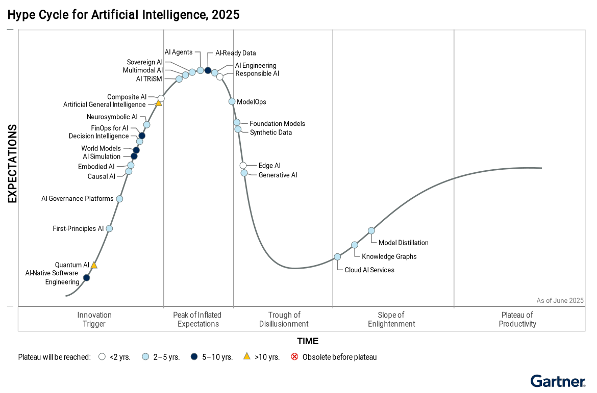

這次的參會重點整理及心得分享：

1\. 開源模型發展趨勢

2\. 小模型不是一無是處

3\. 聯發創新基地的新模型

4\. 開源模型使用起手式

▋開源模型發展趨勢（Credit by 黃瀚萱）

Reasoning標配

Multi-Modal模型

Context Window加大

第一個趨勢是Reasoning，從DeepSeek-r1開始出現，另在ChatGPT觀察到的，在4版的時候會發現它會在結尾才會推導出答案（思維鏈：CoT，Chain of Thought），但在5的時候在開頭就會直接講答案，可以觀察到它把Reasoning思考的那段推論藏起來了，越來越多的模型現在都具備Reasoning的能力。

第二個趨勢是多模態，這其實也可以從ChatGPT的演進觀察到，前陣子剛釋出畫圖功能的時候，一堆人瘋狂生成吉卜力的風格圖（包含我在內XD），開源模型也有類似的路線；例如，Gemma 3、Qwen 2.5 VL、Phi-4 Multimodal、Llama 3.2，雖然OpenAI現在開源的還沒給出多模態（目前GPT-4o有），也許以後會有（礙於現實壓力）

第三個趨勢是上下文視窗(Context Window)，這決定了一次模型可以看的內容量，就好比一目十行跟一個字慢慢看的差別，一個顯著的例子是Llama4，它的Context Window達到空前的高，大約10M，概念像是本來只能一次輸入一張紙的內容，擴充到可以一次給它一套小說集，這樣的好處是可以達到類似記憶的效果，不過僅限於這次的輸入，下一輪它還是會忘記，所以ChatGPT的一個做法是它把講過的話，利用RAG抽取知識Index起來，每次跟它對話，它都會先去看再回答你，感覺就像有記住你說過的話。

很多模型會宣稱他們的Context Window是多少，不過實際測試可能會有落差，可以使用NVIDIA提供的RULER工具：

[https://lnkd.in/gdWBQPWB](https://lnkd.in/gdWBQPWB)

▋小模型不是一無是處（Credit by 許大山）

在有些情況下，是可以考慮用小模型的，測試過效果還不錯。

Open Router

Summary

語音辨識

TTS

Open Router 就像一個 「AI API 聚合器」，讓你透過一個統一的 API，去存取不同廠商或開源社群提供的模型（類似於模型的「App Store」）。

因為小模型的參數量較小，天生有較大的吞吐量，所以它講話的語速會比大模型快很多，因此簡單的任務，小模型就可以表現地又快又好。

如果你的公司或是團體有在Release模型的話，可以考慮放模型上去給別人使用，至少有兩個好處：

1\. 賺奶粉錢

2\. 增加曝光

參考連結：

[https://openrouter.ai/](https://openrouter.ai/)

Summary是指說「總結」相關的功能，小模型也很適合用來幫忙整理資料。我其實有點懷疑ChatGPT之前的版本，前面劈哩啪啦講了一堆，最後的「總之」、「總的來說」後面的那些文字，是不是透過Call Function請小模型整理的？（也有可能不是，回答的pattern是可以對齊的，但目前GPT5的外網搜尋功能無懸念應該就是Call Function）

語音辨識、TTS轉逐字稿，一個常見的開源模型是Whisper，不過因為它沒有針對中文做過優化，所以還需要調整一些東西才會比較好用。

另外，除非有必要才去微調模型，主要的考量是數據成本偏高，舉例來說，一個14b的模型，可能要20-30萬筆的資料才夠。

▋聯發創新基地的新模型（Credit by YC）

主要更新了：Breeze2、Breeze ASR、BreezyVoice。分別用在：AI Agent、語音辨識、語音克隆。

有開放在Huggingface上，可以自行下載來用：

[https://lnkd.in/gGXrfYqm](https://lnkd.in/gGXrfYqm)

▋開源模型使用起手式（Credit by 孫曉恩）

示範了一個有趣的案例，透過RTX 4090工作站，用LM Studio部署Llama-Breeze2-8B-Instruct的模型，透過n8n定義工作流，把流程串起來，流程如下：

語音輸入 -\> Breeze ASR語音辨識轉文字 -> 輸入給Breeze2綜整訊息 -> 摘要後的訊息透過BreezeVoice播放

另外還介紹了台灣的開源模型，除了MediaTek Research之外，還有TAIDE、MiuLab（也許該加上Twinkle AI？）

最後分享了PEFT（Parameter-Efficient Fine-Tuning）的方法，這是源自於這篇論文：Scaling Down to Scale Up:

A Guide to Parameter-Efficient Fine-Tuning，

[https://lnkd.in/g9RdN6Jg](https://lnkd.in/g9RdN6Jg)

我蠻高興有人分享這個，這內容在我書裡也有介紹過：

[https://reurl.cc/KeMXdp](https://reurl.cc/KeMXdp)

PEFT 的方法可以主要分為三個範疇，分別是: 添加法 (additive methods)、 選擇法 (selective methods)、 基於重參數化的方法(Reparameterizations-based methods)。

調節器及軟提示的這些添加法，主要以添加參數的方式作為效率調參的手段，雖然網路的參數增加了，但它們透過減少梯度大小及優化器 (optimizer) 狀態的方式，有效地增加顯卡記憶體及訓練時間兩者的運用效率，除了提升了單位GPU的運算量外，也能以同等硬體規格訓練更大規模的模型；

選擇法則不會添加額外參數，專門針對有興趣調整的地方去調，以全局或局部方式去調整模型偏差、線性層，抑或是稀疏性的混搭方式也行；

基於重參數化的方法則著重在使用了低秩變換以重新參數化網路的權重。這減少了可訓練參數的數量，同時仍允許該方法去處理高維度的矩陣；例如，網路的預訓練參數。

優化方面，後續可以關注: 標準化的PEFT基準、具有卓越參數與秩比的重新參數化技術、超參數和其可解釋性等等。

台灣人工智慧學校（AIA）近期更新：

1\. 協同數發部發佈了「AI產業人才認定指引」：

[https://lnkd.in/gsK4Ecbd](https://lnkd.in/gsK4Ecbd)

2\. 既上次工程級AI素養，推出了管理級AI素養認證：

[https://lnkd.in/gTPjMjh4](https://lnkd.in/gTPjMjh4)

下個月9/9-9/10就是2025 AIA年會了，介紹傳送門：

[https://reurl.cc/VW2XyR](https://reurl.cc/VW2XyR)

歡迎一同來現場交流互動！

