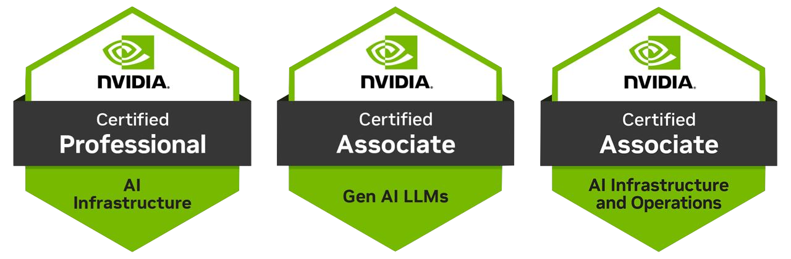

【NVIDIA 證照準備心得】

自從去年 5 月，參加 NVIDIA 的網路研討會，偶然間看到 NVIDIA 證照考取半價優惠，想說給自己一個機會挑展一下自我，於是開啟了考照的連續之路。

我的第一張 NVIDIA 證照，是 NVIDIA Certified Associate | AI Infrastructure and Operations，這個難度算是入門等級，當初的想法很簡單，只是想透過準備證照的過程，進而去理解在這塊有沒有什麼需要補強的地方，畢竟公司提供對應的服務，除了要對客戶負責之外，後續的優化也是我們的重點工作。

報名 NVIDIA 的證照考試，最多會有 60 天的準備期限，報名方式上 certiverse.com 這個網站即可，第一場我是抓 8/31 考試，正常來說，入門級的考試，有計劃性地準備，2 個月綽綽有餘，當然，有需要的話，你也可以今天報名明天考試，如果很有把握的話（不建議）。

Associate 等級的考試，有些會有提供中文應試，所以如果英文不太好，可以選中文考，但我是選全英文的，因為我還要服務國外客戶，對我來說，英文的版本會比較符合客戶的需求（另外私心不想證照上面可能顯示中文，給客戶不好看）。

第一場考試的準備方式，建議可以下載官方提供的考試大綱，裡面會羅列出參考資料，把這些資料全部過一遍就行，雖然是這麼講，但真相是如果你完全沒碰過，2 個月有機率壓到死線，有的參考資料範圍非常的大，幾乎是把原本的技術手冊整份貼給你，剛開始看到其實有點傻眼，但因為那個範疇我以前就看過了，所以沒造成太大的困擾。

我的準備方式是，先把考試大綱的佔比列出來，優先準備佔比高的（考試重點是什麼？當然是要過！洗分數不是重點，以前碰過一個前輩考試全公司最高，老闆常常拿來說嘴，我不太認同），把這些文檔盡量弄成PDF，然後傳到 Notebookllm 去幫你摘要，還可以出模擬練習題（但實際考試有的題目是多選，得自求多福），沒有PDF的，就把網址貼上去，摘要效果會差一點，然後有些網站我有發現是沒法直接摘要的，這時候就要把整個網頁的重點內容貼到 Notebookllm。

再來，就是要計劃準備的節奏，60 天來算約為 8 週，以週為單位去計算每天要看完多少資料，還要加上複習、模擬考的時間，這個就看個人造化，按照自身情況去調整備考策略。
我第一次準備時間很趕，報完名後，那陣子工作很忙，所以大概只有衝刺個 2 週多就考試了，對有經驗的人來說，這樣的時間還算 OK。

第一次考試，一開始網路連線不穩，只好求助線上客服，全英文溝通，有點手忙腳亂，後來因為他證件要看實體的，那時候剛好沒帶護照，好家在可以用身分證頂替，線上可以直接請客服修改，算是福星高照。

遠端考試之前，監考官會要求看你周遭的環境，必須要淨空，他會透過鏡頭掃描你整個區域，考試期間，不得回頭或是離開位置，必須遵守相關的考場規定，有疑問需要先告知監考官，他也會要求你從頭到位都要能看到你的頭，頭不能超過鏡頭的區域（這樣身體就必須要長時間維持相同姿勢，說實話有點辛苦，不能亂動）

考試期間，必須有效分配時間，Associate 的時間是一個小時，所以要抓 40 分鐘內寫完，20 分鐘檢查，以 50 題來算一題不能超過一分鐘，我的策略是確定對的題目就不會特別標注，有疑慮就先標起來，這樣後面檢查會節省很多時間，因為題目是一題一題看的，如果一個個切的話太花時間。

題目來說，有認真準備的話，不算太難，應該都能過。我那時候有提前交卷，很高興通過了（考完興奮地奪門而出，啊不是，已經遲到了，趕著去赴約）。

第二張 NVIDIA 證照，我是選 NVIDIA Certified Associate | Generative AI LLMs，主要是為了服務客戶用的，我們常會碰到有客戶詢問關於選模型的這件事情，這題其實不太好回答，要看應用場景跟實際需求才能決定。透過準備這張證照，我想就能系統性地掌握大型語言模型相關的知識，就能基於這樣的架構去協助解決客戶的潛在問題，能夠更好地服務客戶。

考第二張的時候，算是駕輕就熟，除了網路的部分還是有不穩的情形有點無言外，其他的都算順利，也順順地通過了。

第二次考完不久，我不禁在想，還有需要再考一張 Associate 證書嗎？感覺沒有太大意義，我想試試不一樣的，但是以 Professional 等級的難度來說，不曉得有沒有需要上課才能考過，因為那一張就要 400 美，就算給你半價也要 200，不是小數目，後來，我決定賭一把，人生就該挑戰不一樣的可能性，如果每天過得像鹹魚一樣，那跟行屍走肉有什麼區別？

第三張 NVIDIA 證照，我是選 NVIDIA Certified Professional | AI Infrastructure，那是因為我相信，透過這次的準備，可以更全面地瞭解資料中心的建置、實施、部署相關的流程，雖然我們已經幫客戶做過很多遍了，但行走江湖，還是要懂得精益求精、與時俱進，這樣才是對客戶真正負責任。

這張的難度的確不小，光是參考資料就是入門級的兩倍以上，所以如果沒有一定程度的準備是過不了的，而且它沒有中文版，只能用英文應試，所以英文閱讀能力蠻重要的。後續有時間，我再寫個系統性的介紹，知識點很多，主要聚焦在 NVIDIA 在資料中心的解決方案。

我當時在準備這張的時候，不敢掉以輕心，算是扎實地準備了兩個月，那時候跨過年，幾乎都待在家裡閉關（除了花了 2 天看「我獨自升級」），很像以前考 NVIDIA DLI 講師的時候，不過時間更長就是了。

考試當天，網路的問題又來，還好線上客服可以搞定，這次監考官有點雷，考到一半切換題目開始 LAG，過一陣子監考官自己下線（我無語，當下思考著這是要？），還好後來他回來了，就這樣一路到結束。

這次寫得很趕，有點擔心寫不完，還好後來有追上時間，最後剩 3 分鐘交卷，然後幸運地過了，天助我也。

縱觀這三次考試，算是有驚無險、否極泰來，其中難免有些運氣的成分，也間接證明我的實力，人生沒有偶然，也沒有絕對的必然，我們唯有堅定自我的目標，砥礪前行，才能不浪費自己的人生，共勉之。

Nick 2026.04.11 於 新北市

\# 全文無使用 AI，純手打，沒有加料成分