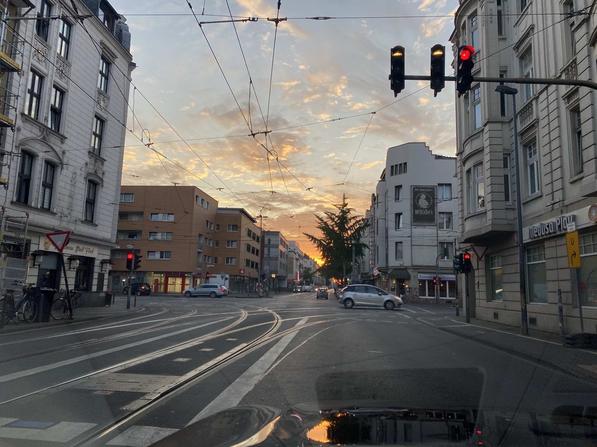
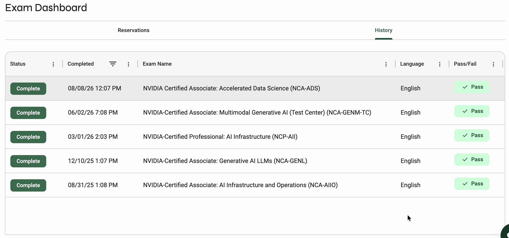
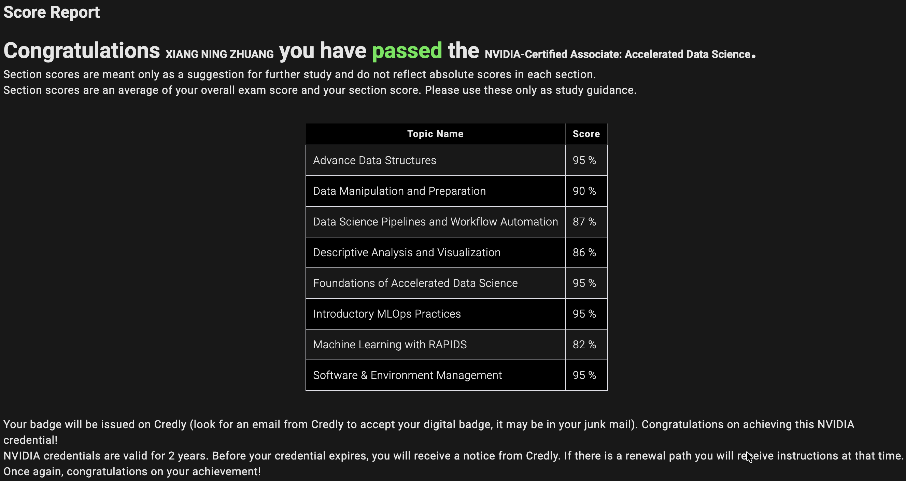

今天適逢父親節，先祝福天下的爸爸們父親節快樂！

今天同時也是我拿到第5張NVIDIA認證的日子，回顧這一年的時間，每2~3個月不間斷的考試，除了想證明自己的能力之外，也想透過這個過程去了解NVIDIA整個生態系的系統知識，從AI基礎設施到系統驅動，從系統驅動到應用層，其中的許多環節是環環相扣，缺一不可，不過主軸來說都是以GPU加速技術為主，僅限於NVIDIA的範圍。

NVIDIA的基礎設施，從硬體架構的BasePOD、SuperPOD，到NVAIE的架構整合，可以看到就是軟硬體互相協作的重要性，也包含了對底層GPU的了解程度，驅動的設定，跟哪些軟體有關，像是：CUDA、NVCC、NVIDIA-SMI等等，其實以底層邏輯來說，就是把資料運算盡可能放到GPU上面，然後因為寫回到硬碟這段需要CPU跟IO Disk去處理，所以也需要去避免GPU和CPU頻繁的溝通問題，這是單台機器的部分。多台機器，就牽涉到網路傳輸，網路有三種：RJ45、光纖、以及IB卡，要不要用IB？是否有支援Direct RDMA？等等的問題需要去討論。

應用層的議題，就跟cuML、cuPy、RAPIDS的設定有關，從單台的資料交換，乃至於多台的Dask設定，每一段都需要調校，以達到最好的性能傳輸比。

這次考試，跟上次不一樣的是，沒有裸機上陣，因為資料科學家這段離我比較遠，相對沒那麼熟悉，所以稍微花了一點時間準備，成效還不錯，是歷屆考試分數最高的(Score:91)，那時候線上交卷的時候有點嚇到，比我預期的好蠻多，也感謝本身自帶的好運氣。

這次考試非常的順利，明顯感覺到Certiverse有進步，以往考試問題一大堆，考試期間累格、斷線、卡頓都有可能，但這次都沒有碰到，也沒有考官到一半消失的問題，順暢地開場與收尾，算是可喜可賀。

後續應該暫時不會再考NVIDIA的認證，助理級認證已經全部考過，有兩次是NVIDIA贈送的，非常感謝，後面看緣分再決定要不要更新，也是時候邁出下一步去思考其他的可能性了，嘗試其他的挑戰之類的，總是期許自己能夠不斷成長進步，人生可以很長，也可以很短，持續保持堅定的信念，相信自己，就能活出一段無怨無悔的人生。

---

*Nick 2026.08.08 於 桃園*

*照片 攝於 德國 - 科隆市 - 2025.07.30*
