# 【企業 AI 基礎建設全攻略：從網路底層到 AI 應用的完整藍圖】

前篇分享了考 NVIDIA 認證的心路歷程，這篇來細聊 NVIDIA Certified Professional | AI Infrastructure 這張證照真正在考的東西——也就是 **AI Infrastructure** 的行業觀察與技術全貌。

老實說，這張證照之所以有挑戰性，不在題目刁鑽，而在它考的是「整棟大樓」，不是某個房間。打造企業級 AI 基礎建設，從來不是「買幾張 GPU 裝起來」就能解決的事——從底層網路的傳輸頻寬、硬體拓撲的延遲控制、GPU 資源的虛擬化策略，到上層軟體平台的統一管理，每一層環環相扣，少一塊就成為「木桶效應」裡的那塊短板。

這篇我會由下而上，把整個架構走一遍，順便分享一些我在實務上踩過的觀察。

---

## 一、鳥瞰全局：企業 AI 工廠的五層架構

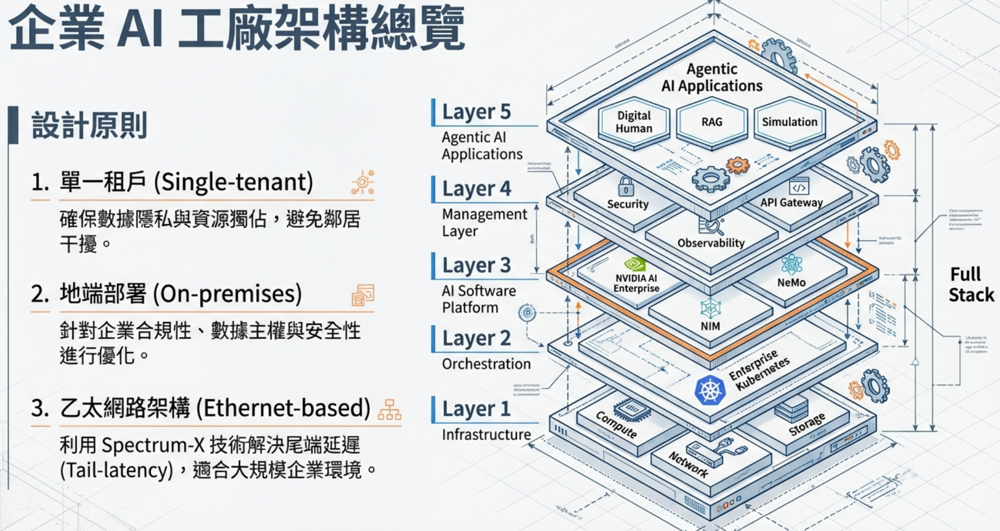

深入細節之前，先建立整體觀，這個習慣我覺得很重要。

企業 AI 工廠採用五層設計，可以把它想像成一棟大樓，由地基往上蓋：

| 層級    | 核心功能                                                           |
| ----- | -------------------------------------------------------------- |
| Layer 1 | Infrastructure — 計算、網路、儲存的實體基礎                                 |
| Layer 2 | Orchestration — Enterprise Kubernetes 資源調度                     |
| Layer 3 | AI Software Platform — NVIDIA AI Enterprise、NIM 推論服務            |
| Layer 4 | Management Layer — 安全、可觀測性、API Gateway                         |
| Layer 5 | Agentic AI Applications — Digital Human、RAG、Simulation         |

這套架構有三個核心設計原則，是貫穿全部技術選型的「DNA」：

- **單一租戶（Single-tenant）**：確保資料隱私，企業內部資料不會跟別人混在一起。
- **地端部署（On-premises）**：滿足法規與資料主權的需求，這在金融、醫療、政府這幾個產業特別有感。
- **乙太網路架構（Ethernet-based）**：透過 Spectrum-X 技術解決大規模叢集中的尾端延遲（Tail-latency）問題。

了解這五層之後，接下來的每張圖、每個技術點，都是在「填充」這棟大樓的細節，學起來就會有脈絡，不是一堆孤立的名詞。

---

## 二、地基決定高度：高速網路的演進（Layer 1）

有一個觀念要先建立——任何 AI 訓練工作負載的瓶頸，往往不在 GPU 本身，而在 GPU 之間的資料傳輸速度。GPU 再快，資料送不過去也是空轉，這就是為什麼 NVIDIA 不停在網路這塊砸資源。

### 2-1. 從 SDR 到 NDR：頻寬的指數級躍升

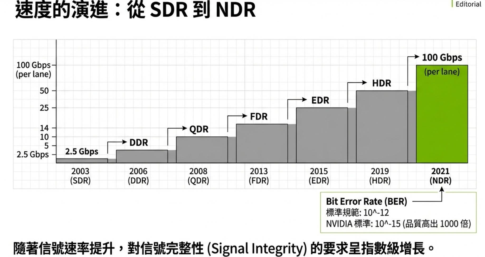

InfiniBand 技術的演進，清楚說明了這條路走了多遠：

- 2003 年 SDR：每通道 2.5 Gbps
- 2021 年 NDR：每通道 100 Gbps，近 40 倍的提升

但速度的提升並非沒有代價——隨著信號速率增加，對信號完整性（Signal Integrity）的要求呈指數級上升，誤碼率（BER）標準要達到 10⁻¹²，品質要求比舊世代高出 1000 倍。這意味著機房佈線、Switch 選型、NIC 品質都要同步升級，任何一環不夠力，整個系統就會卡在那裡，這也是「木桶效應」最直觀的展現。

### 2-2. RDMA：讓 CPU 從資料搬運工中解放

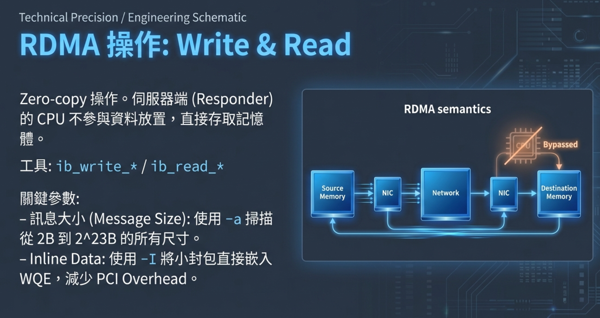

頻寬解決了「多快」的問題，RDMA 解決的則是「多省」的問題。

RDMA（Remote Direct Memory Access）的核心是 **Zero-copy** 操作：伺服器端 CPU 完全不參與資料的放置，Source Memory 的內容直接透過 NIC → Network → NIC 寫入 Destination Memory，CPU 整個被 Bypass 掉，等於工地裡的搬運工被解雇，工地老闆專心做設計就好。

這帶來兩個關鍵優勢：

- **延遲極低**：省去 CPU 介入的 context switch 開銷
- **CPU 資源釋放**：CPU 可以專注在計算，而不是當搬磚的苦力

▋ Pro Tip：實務測試工具 `ib_write_*` / `ib_read_*` 可以掃描從 2B 到 2²³B 的所有訊息大小，部署之前先跑一輪，幫你找出最佳傳輸參數，不然到時候上線發現吞吐不如預期，回頭追原因會很痛。

---

## 三、拓撲決定效率：NUMA 親和性與多節點擴展（Layer 1 延伸）

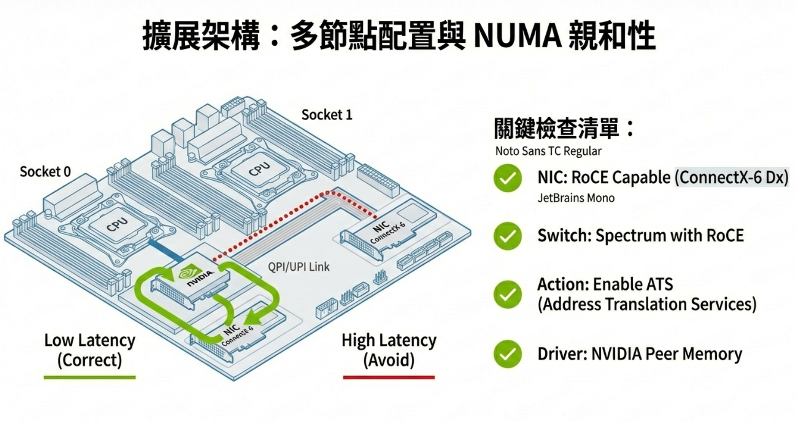

有了高速網路，還要確保封包「走對路」。高速公路修好了，但你的車偏偏被導去走慢車道，這條路再快也沒用。

### 3-1. NUMA 親和性：低延遲的隱形關鍵

在多 CPU Socket 的伺服器中，GPU 通常透過 PCIe 連接到特定 Socket 上的 CPU。若資料路徑跨 Socket（High Latency 路徑），延遲會顯著上升，而且這種延遲很難從應用層直覺察覺，是個「隱形殺手」。

正確做法（Low Latency）：確保 GPU 與其對應 NIC 的資料路徑，都走同一個 Socket 的 QPI/UPI Link，避免跨 Socket 的 NUMA 懲罰。

部署前的關鍵檢查清單，缺一不可：

- NIC 必須支援 RoCE（如 ConnectX-6 Dx）
- Switch 選用支援 RoCE 的 Spectrum 系列
- 啟用 ATS（Address Translation Services）
- 安裝 NVIDIA Peer Memory Driver

這節跟上一節的 RDMA 是直接呼應的——RDMA 提供傳輸協議，NUMA 親和性確保實體路徑最短、延遲最低，兩者缺一不可，這也是這張證照很愛考的組合題。

---

## 四、GPU 資源虛擬化：讓一張卡服務多種需求（Layer 2）

實體網路就緒，下一步是怎麼把昂貴的 GPU 資源最大化利用。畢竟一張 H100 動輒幾百萬，沒有人會買來給單一使用者佔住不放，必須有切分與共享的機制。

### 4-1. 選對 vGPU 類型：Q、B、A 系列策略矩陣

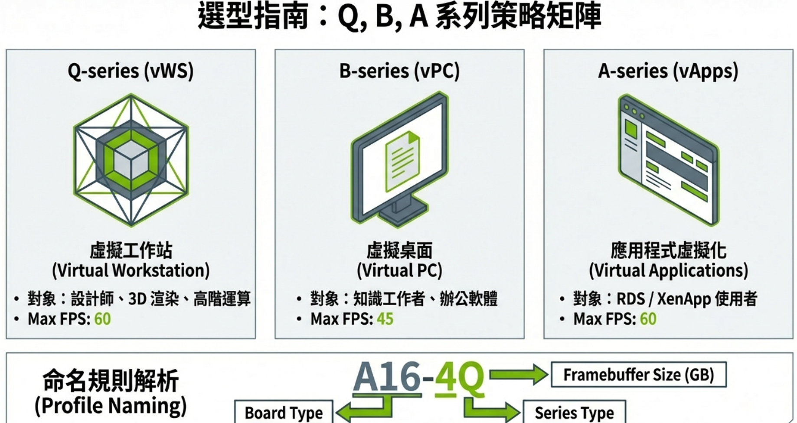

不同使用場景對 GPU 的需求截然不同，NVIDIA vGPU 提供三個系列，坦白說剛接觸真的蠻容易搞混的，整理成表格比較清楚：

| 系列                 | 定位      | 目標用戶              | Max FPS |
| ------------------ | ------- | ----------------- | ------- |
| Q-series（vWS）       | 虛擬工作站  | 設計師、3D 渲染、高階運算    | 60      |
| B-series（vPC）       | 虛擬桌面    | 知識工作者、辦公軟體        | 45      |
| A-series（vApps）     | 應用程式虛擬化 | RDS / XenApp 使用者  | 60      |

Profile 命名規則其實一目了然，以 `A16-4Q` 為例：`A16` 是板卡型號，`4` 是 Framebuffer 大小（GB），`Q` 代表 Q-series 類型。看懂規則之後選型其實沒什麼難度。

### 4-2. MIG 與 Time Slicing：進階 GPU 隔離策略

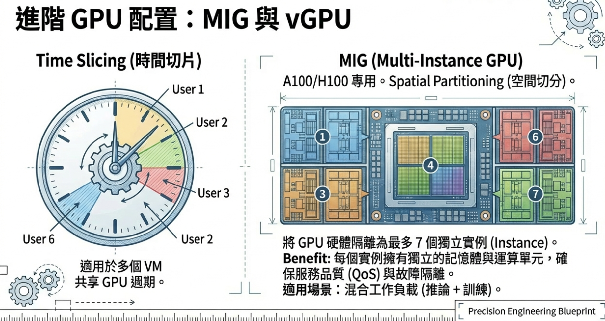

選定 vGPU 系列後，還要決定 GPU 的切割方式，這是兩種完全不同的哲學：

- **Time Slicing（時間切片）**：多個 VM 輪流使用整張 GPU，適合資源需求不高、可以容忍共享的場景。概念上有點像共享辦公室，大家輪流用會議室，省錢但不保證 QoS。

- **MIG（Multi-Instance GPU）**：A100 / H100 專屬技術，採用空間切分（Spatial Partitioning），可將一張 GPU 切成最多 7 個完全獨立的 Instance。每個 Instance 都有獨立的記憶體與運算單元，實現真正的 QoS 保證與故障隔離。

MIG 最厲害的地方在於：同一張卡可以同時服務推論（低延遲、小 batch）與訓練（高吞吐、大 batch）兩種截然不同的工作負載，這在混合場景下非常實用，也是企業客戶最常問的應用題之一。

---

## 五、軟體平台：讓硬體發揮最大潛力（Layer 3）

硬體準備完畢，接下來是軟體堆疊的統一管理。這一層決定了「能不能用好」的問題——硬體再強，沒有好的軟體棧也是英雄無用武之地。

### 5-1. NVIDIA AI Enterprise：從底層到框架的全棧認證

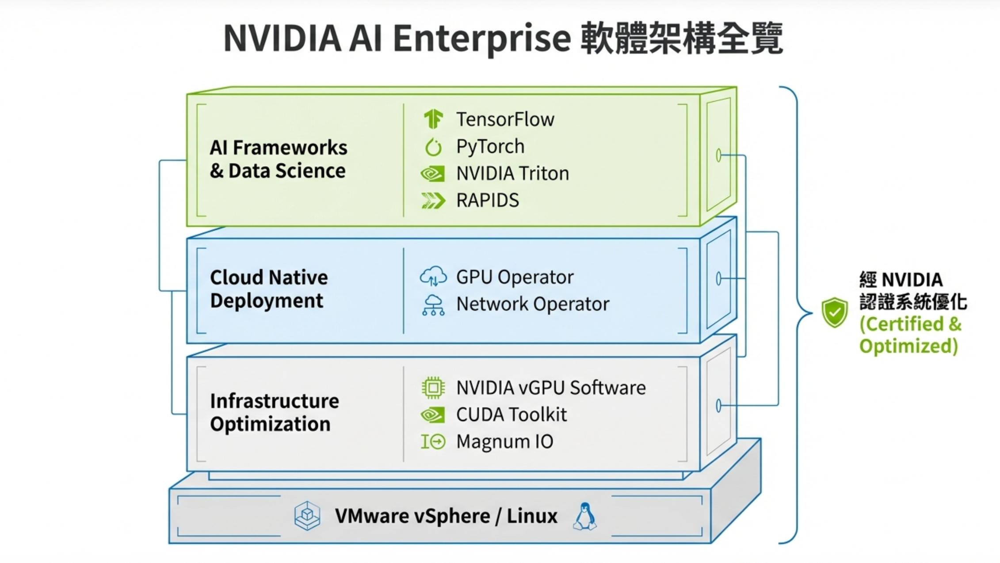

NVIDIA AI Enterprise（NVAIE）提供三層軟體架構，由下而上分別是：

- **Infrastructure Optimization**：NVIDIA vGPU Software、CUDA Toolkit、Magnum IO，直接優化硬體效能
- **Cloud Native Deployment**：GPU Operator、Network Operator，以 Kubernetes-native 方式自動化 GPU 節點的部署與配置，不用一台一台手動裝
- **AI Frameworks & Data Science**：TensorFlow、PyTorch、NVIDIA Triton、RAPIDS，提供完整的 AI 開發工具鏈

整套堆疊都經過 NVIDIA 認證（Certified & Optimized），運行在 VMware vSphere 或 Linux 之上，這對企業來說是個重點，出問題有原廠可以找，不是 DIY 出來的孤兒系統。

### 5-2. NGC：統一的容器與模型入口

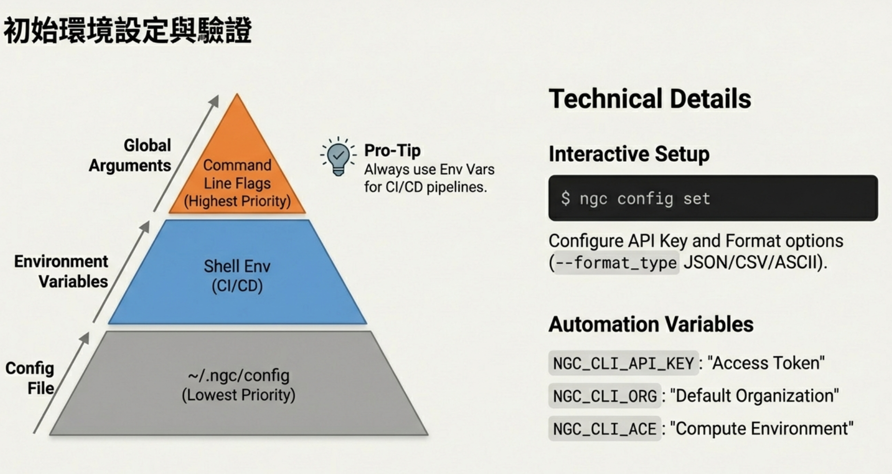

有了軟體堆疊，工程師要快速取用 NVIDIA 提供的預訓練模型與容器，答案就是 **NGC（NVIDIA GPU Cloud）CLI**。

NGC 的配置優先級採金字塔結構（由低到高）：

- 最底層：`~/.ngc/config`（Config File）
- 中層：Shell Environment Variables（適合 CI/CD 自動化）
- 最高層：Command Line Flags（最高優先，適合臨時覆蓋）

▋ Pro Tip：CI/CD Pipeline 務必使用環境變數，透過 `NGC_CLI_API_KEY`、`NGC_CLI_ORG`、`NGC_CLI_ACE` 三個變數即可完成所有自動化配置，無需手動登入，省掉非常多麻煩，尤其是多人協作的場景。

### 5-3. NVIDIA-SMI：運維工程師的第一道防線

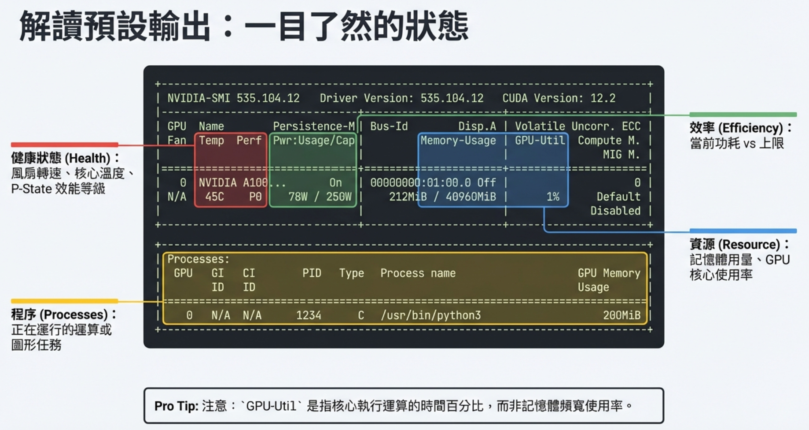

環境啟動之後，日常運維需要即時掌握 GPU 狀態，`nvidia-smi` 的輸出包含三大區塊，每一塊都有意義：

- **健康（Health）**：風扇轉速、核心溫度（如 45°C）、P-State 效能等級
- **資源（Resource）**：記憶體用量（如 212MiB / 40960MiB）、GPU-Util 核心使用率

  ▋ 注意：GPU-Util 是核心執行運算的時間百分比，不是記憶體頻寬使用率，這兩個常常被搞混。
- **程序（Process）**：正在運行的任務 PID 與 GPU Memory 佔用

NVIDIA-SMI 是 Layer 4 可觀測性（Observability）的起點，也是連接軟體層與硬體狀態的橋樑——出問題先跑這個，是運維工程師的標準動作。

---

## 六、節點全生命週期管理：讓叢集自動運轉

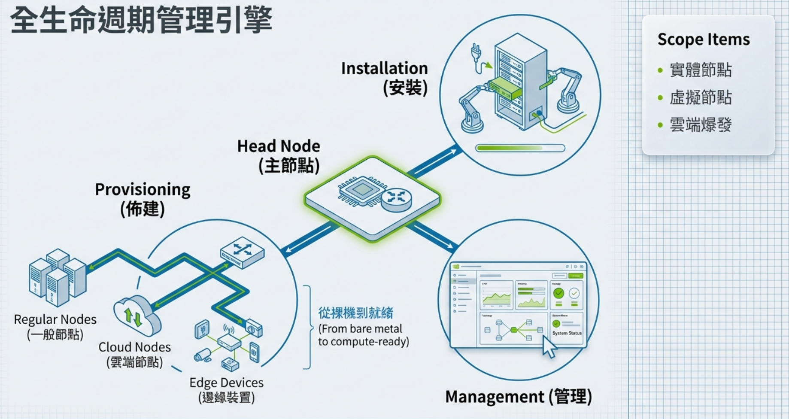

單一節點的配置解決了，但企業環境動輒數十、數百個節點，總不可能一台一台手動處理，這就需要一個統一的全生命週期管理引擎。

架構以 **Head Node（主節點）** 為核心，管理三類計算資源：

- **Regular Nodes（一般節點）**：固定實體機器
- **Cloud Nodes（雲端節點）**：動態擴展的雲端運算
- **Edge Devices（邊緣裝置）**：靠近資料源的推論節點

管理流程分三個階段：**Provisioning（佈建）→ Installation（安裝）→ Management（管理）**，從裸機（Bare Metal）到 Compute-Ready 狀態全程自動化。

這一層直接承接上一節的軟體配置，NGC 下載的容器與模型，會在這個管理框架下被統一分發到各節點，整條鏈路是通的。實務上沒有這套，光是手動裝幾百台節點，人力成本根本吃不消。

---

## 七、AI 應用頂點：NeMo Framework 與端到端訓練（Layer 5）

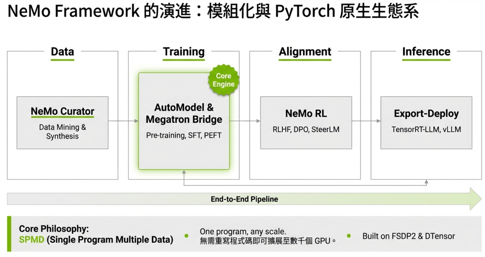

所有基礎建設最終服務的目標，是讓 AI 模型能夠被高效訓練與部署。這一層是整棟 AI 工廠大樓的「出貨口」。

NeMo Framework 提供了完整的端到端 LLM 開發管線：

```
Data           →  Training           →  Alignment        →  Inference
NeMo Curator      AutoModel &            NeMo RL             Export-Deploy
(資料挖掘與合成)   Megatron Bridge        (RLHF, DPO,         (TensorRT-LLM,
                  (Pre-training,         SteerLM)            vLLM)
                  SFT, PEFT)
```

NeMo 的核心哲學是 **SPMD（Single Program Multiple Data）**：同一份程式碼無需修改，即可從單機擴展到數千張 GPU，底層依賴 FSDP2 & DTensor 實現分散式訓練。這個設計非常務實——工程師不用為了擴展去改架構，省下大量的時間成本。

底層的 RDMA 高速網路、NUMA 優化的多節點叢集、MIG 切分的 GPU 資源、NVAIE 統一的軟體平台，全都在這一層匯聚，驅動大型語言模型從資料到部署的完整旅程。

---

## 回頭看：從地基到頂層的完整脈絡

學完這些，整個架構的邏輯就清晰了，從下往上走一遍：

```
AI Factory 五層架構（全局觀）
    ↓
RDMA 高速網路 + NUMA 親和性（Layer 1：消除傳輸瓶頸）
    ↓
vGPU 系列選型 + MIG 切割策略（Layer 2：GPU 資源最大化）
    ↓
NVAIE + NGC + nvidia-smi（Layer 3-4：軟體平台與可觀測性）
    ↓
節點全生命週期管理（橫跨各層的自動化）
    ↓
NeMo Framework 端到端 AI 管線（Layer 5：AI 價值實現）
```

每一層都不是孤立的技術選擇，而是為下一層提供穩定的基礎。建設企業 AI 基礎建設，正是這樣一個由下而上、環環相扣的工程旅程。

坦白說，這也是我覺得考這張證照真正有價值的地方——它逼你建立系統性的全局觀，而不只是會背知識點。實務上做過幾個專案後再回頭看這些內容，會發現每一個設計決策都不是隨便定的，而是上下游互相妥協後的結果，當你能理解「為什麼長這樣」，而不只是「它長這樣」，那這張證照的錢就花得值了。

知識如果不能應用的話，那就只是知識而已。能把這套架構放進客戶的場景裡解題，才是這些備考時間真正的回報，共勉之。

全文改寫自備考筆記，技術內容基於 NVIDIA 官方文件。

Nick 2026.05 於 新北市
