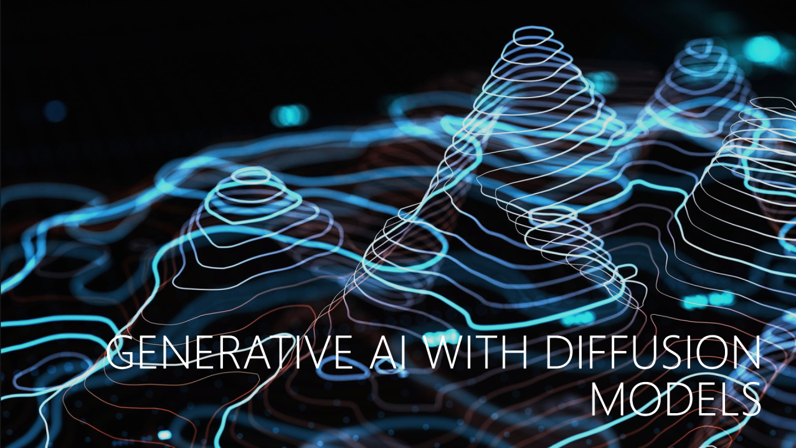

1. U-Nets -> Diffusion

2. DDPM

3. 優化方式

4. Classifier Free Diffusion

5. CLIP

6. 總結

## 1. U-Nets -> Diffusion

第一部分，講述了早期圖像生成AI的發展史，並引出了一個重要的觀念：轉置卷積（Transposed convolution），這使得生成新圖像的GAN、分割網路的U-Net得以發揮作用，並比較了轉置卷積及反卷積（Deconvolution）的差異。

## 2. DDPM

第二部分，描述了去雜訊擴散機率模型（Denoising Diffusion Probabilistic Model, DDPM），擴散的原理就像是將一滴墨水倒入至清水中，隨著時間的推移，整杯水會變成灰色，而生成圖像是運用反向擴散（Reverse diffusion）的流程去產生圖片。

## 3. 優化方式

第三部分，列舉了關於模型架構的優化方式，包含：可視化儀表板的優化、組正規化（Group normalization, GN）、GELU、重排池化（Rearrange pooling）等。可視化儀表板優化是指將生成圖像變得更加易於辨識的方法；GN是一種讓模型可以加速收斂的方法，其他方法還有BN、LN、IN；GELU是類似RELU的激活函數，優點是小於0的梯度不會歸零；重排池化不同於最大池化（Max pooling），它讓模型自行決定要保留的特徵。

## 4. Classifier Free Diffusion

第四部分，介紹了無分類器的引導（Classifier Free Guidance），這是目前擴散模型發展的主流思想之一，這個方法的好處是我們在訓練擴散模型的時候，對於每個不同的類別，不用去訓練對應的分類器。

## 5. CLIP

第五部分，提到了對比語言-影像預訓練（Contrastive Language–Image Pre-training, CLIP），這是一種透過文字描述與影像匹配來訓練模型的方法，讓沒看過的影像可以產生對應文字描述的功能。

## 6. 總結

第六部分，整體來說，羅列了VAE、GAN、Diffusion、CLIP等不同的模型架構，比較了其中的差異，並期許未來能打造出可信任的AI（Trust Worthy AI）。

更多細節歡迎參考課程內容，如果你是新用戶，可以註冊並選擇免費的一門課程，這門有包含在選項內，另外也有LLM的課。

如果你對圖像生成式AI有興趣，可以參考之前我寫的系列文： [AIGC系列文](https://nickzhuang.com/posts/aigc-origin)

更詳實的內容可參考我寫的書，繁體中文第一本講述圖像生成式AI理論與實務的書籍： [https://reurl.cc/KeMXdp](https://l.facebook.com/l.php?u=https%3A%2F%2Freurl.cc%2FKeMXdp%3Ffbclid%3DIwZXh0bgNhZW0CMTAAYnJpZBExejNhZW1EZFBVRDluQnl4VwEe9c772XtKMdlOdQFhYszc-Dw9MRKhGTlg4yVe5riUcbNBUD63K59GI2QH4_I_aem_Up9YDP-YsOAHGF5hsHs2Zg&h=AT1cikxGP5awloaNq4V2WR_N56y9Mt5FEQY61p76w7Ei3j1ym9N5LFPLV8GFDZ65RTllrce6J76zSRFJC0Jmq2vqPXw-ZIO3bvlNQxPy3r1tqX8EdtS7GRVf0dwzO8z1wbw6OtBWQnwSY-VO9yapIJR6Q1t-YQCIyVc&__tn__=-UK-R&c[0]=AT1ndAcvwKM3IewVVI1Lp7IFELPPqMfpWhb7fkjpulVRJlvPXYVW70uyWSgF-AivRlr5ZgudGJ2gXrwrYsB1tZBjMr5r3Q6WcH3QknAoWxjUT5xN7NvTbZ1BqDX5x6IPyhB4I2dqo6kebgcL6KS-6mHGeQZekYqtMPTJmlH0ZHgq2CUZ7jmHRT-sy0NFW0VqTQp-zG8L4mi5G6PuAg)

真心感謝大家對於書籍的支持，上市已經超過3個月依舊在排行榜上，謝謝。

近期的圖像生成AI新論文消息，可以參考這裡： [Stable Diffusion 生態論文精選](https://l.facebook.com/l.php?u=https%3A%2F%2Freurl.cc%2Fqv5aGg%3Ffbclid%3DIwZXh0bgNhZW0CMTAAYnJpZBExejNhZW1EZFBVRDluQnl4VwEe0bCdusXDKHinAZ7-HRfqsPj-iyHOoSD4cV-KRtR6dQZQHjvemQekz4VQvgI_aem_Eljct4d217cGMxOESiwwpg&h=AT02wY63g8v3lJBvnlKvPa_RfvjAvyfecXuR-ll1f3yur5wClfhvDukeX4B8q6EQXX5IcgZ5ol2S2TjDbLAgmzGTvFTAlofai0fbHdmgjgNrsoSfw3mptrebvojPKYUXp_JUvelWyChccWKmDJ6vF8VHO99iX-u0Cs0&__tn__=-UK-R&c[0]=AT1ndAcvwKM3IewVVI1Lp7IFELPPqMfpWhb7fkjpulVRJlvPXYVW70uyWSgF-AivRlr5ZgudGJ2gXrwrYsB1tZBjMr5r3Q6WcH3QknAoWxjUT5xN7NvTbZ1BqDX5x6IPyhB4I2dqo6kebgcL6KS-6mHGeQZekYqtMPTJmlH0ZHgq2CUZ7jmHRT-sy0NFW0VqTQp-zG8L4mi5G6PuAg)
