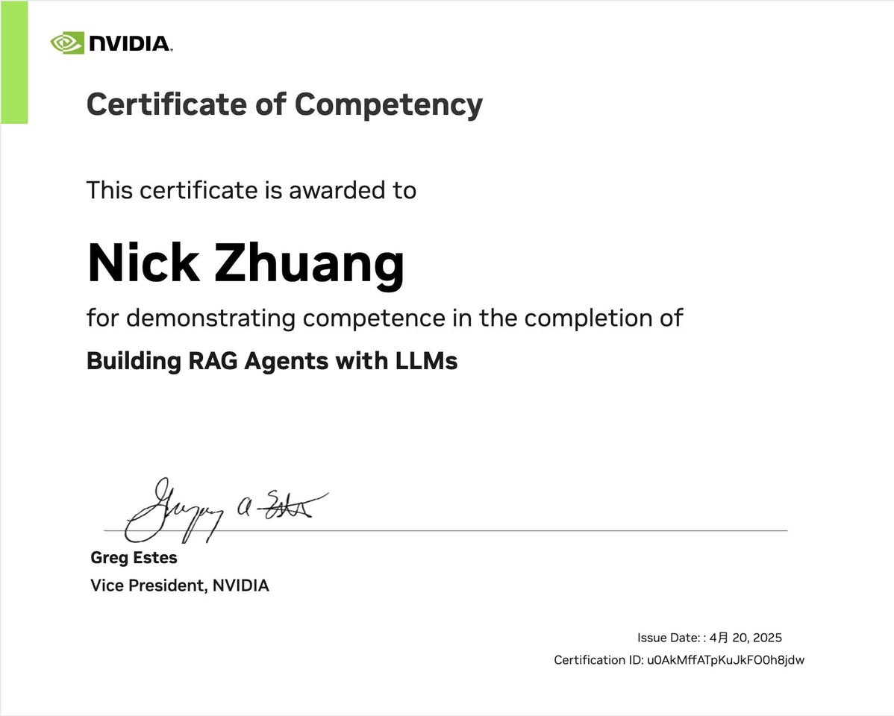
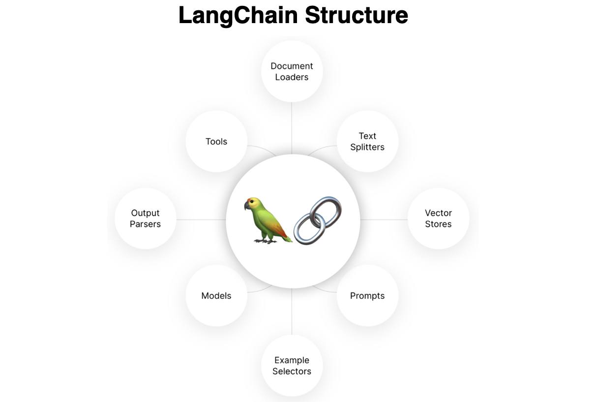
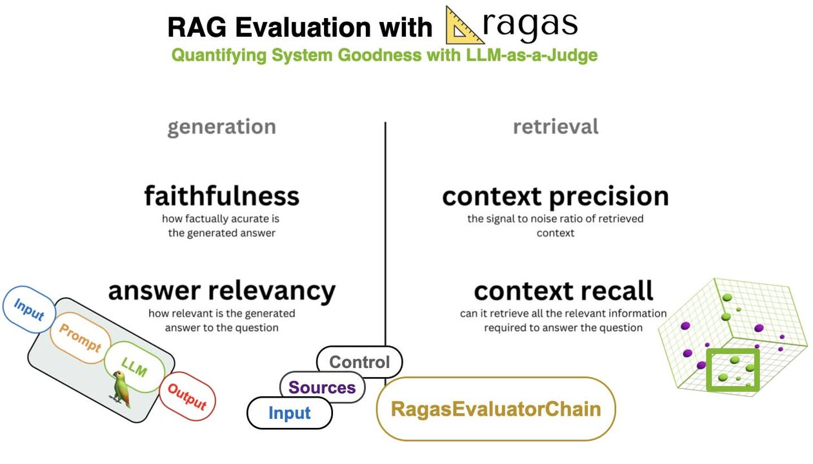

### 前言

這兩天趁著一些空檔，火速將拖了快一個月的NV課程結束掉，這門課雖然講授的時間沒有很長，但練習蠻花時間，另外還提供額外的Bonus習題幫助學習，有興趣可以挑戰看看。

### 什麼是LangChain？

分享幾個重要的知識點：

1\. 主要用到LangChain：要先理解它是一種語言表達式，就好像不同的語言語系會有不同的文法一樣。它的用法是定義各種不同的鏈，透過invoke的方式串接起來，舉例來說，如果你要自己做聊天機器人，就可以用有記憶功能的ConversationalRetrievalChain，也可以進一步搭配RAG的設計，運用RunnableSequence將這些工作流串接在一起，實作一個KM（Knowledge Management，知識管理庫）。

2\. LLM的選擇：如果是用ChatGPT這種，可以用from\_messages的方法設計prompt，如果是LlaMA，則可以用from\_template的方式去處理，會有對應不同格式的字串要定義。

3\. LanServe v.s. LangChain v.s. LlamaIndex：LangChain像是積木組合包，你可以拿不同種類的積木組合成你想要的東西；至於LanServe是用來開放服務用的，可以透過這個框架快速啟動API Server，讓你的旅館可以熱情開張；LlamaIndex是偏向資料處理的，如果你對RAG有更細緻操作需求可以考慮用。

### 概念補充

補充幾個重要的概念：

1\. 要選哪種LLM：要看應用決定，不過泛用性高的開源模型，不外乎就gemma:27b、llama3:8b、qwen:32b，這些都是可以透過Hugginface找到，如果你會用ollama的話，可以直接下指令就能下載。

▋必須要考慮GPU顯存是否夠用的問題，粗估的方式：訓練4倍、推論2倍，舉例來說，如果是用llama3:8b，訓練要用的顯存是8\*4=32GB，推論則是一半，為16GB。網路上提供的計算公式，坦白說不太親民，有點太複雜，當然如果有精算需求的話，還是找專家協助評估會比較好。

▋要多少參數量才夠？一般來說選用開源的Foundation Model，至少66b以上，使用起來感覺才不會那麼智力不足。

2\. 要不要用RAG：看需求，如果套用LLM就已足夠，就不需要，但坦白講機率蠻低，大部分客戶一定會問RAG的Support，目前以開源模型Context Window越來越大的態勢來看，單次輸入模型的最大理解字數會變大，也許後面可以不用，但現階段還是有需求。

### 上課方式

最後提供上課的方式，現在NVIDIA DLI的新註冊用戶，都能獲得一門免費的課程，這個要靠email註冊，也就是說，如果你有N個email，就能上N個課程，嘿嘿，連結： [加入 NVIDIA 開發者計劃，免費領取一門 NVIDIA 深度學習培訓中心（DLI）自學課程](https://developer.nvidia.cn/join-nvidia-developer-program?fbclid=IwZXh0bgNhZW0CMTAAYnJpZBExejNhZW1EZFBVRDluQnl4VwEeUQ1V5h7U7NzNt5C9in4MNi-HfIJ-pmGOvSS6tiUkiYcozTqqL9ep4VA2Ees_aem_8t4b_LX6cj-qnTaMTB1kxw)

